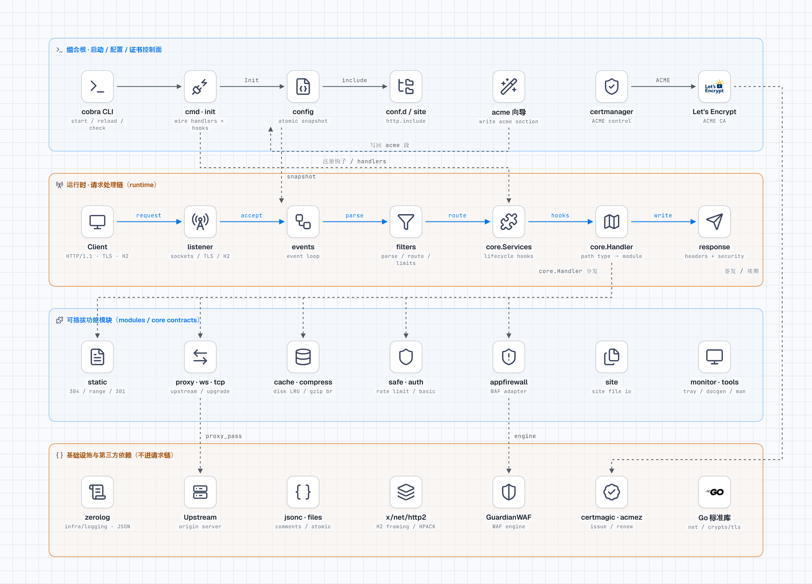

<h1 align="center">Fast-Https</h1>

<p align="center"><strong>A lightweight web server and reverse proxy written in Go: single binary, JSON config, HTTP/2 and automatic HTTPS.</strong><br />
One JSON file describes listen ports and locations, covering common site and reverse-proxy scenarios.</p>

<p align="center">
  
  
  
  
  
  
  
</p>

<p align="center">
  
</p>

<p align="center"><a href="README.md">简体中文</a> | English</p>

## What is Fast-Https?

**Fast-Https is an open-source web server and reverse proxy written in Go.** It accepts connections, parses HTTP/1.1, and writes responses itself instead of wrapping an existing server. HTTP/2 framing and HPACK are delegated to `golang.org/x/net/http2`; TLS comes from the Go standard library.

HTTPS configures itself: put `443 ssl h2` in `listen` and TLS is on — no certificates to prepare up front. A self-signed certificate is generated at first start; for a publicly trusted certificate, the `fast-https acme` wizard connects Let's Encrypt or another ACME CA, and both issuance and renewal are automatic. If ACME issuance fails, the server falls back to self-signed so the site stays reachable.

Everything compiles into a single executable with no extra shared libraries or runtime scripts. Configuration is one JSON file that accepts comments, with routing organized in `location` blocks. It runs on Linux, macOS, and Windows, and can install itself as a system service.

How a request travels:

```text
connection → rate limit / IP blacklist → location routing → application firewall → static file / reverse proxy / TCP / WebSocket → response
```

## Architecture



Blue is the primary request path; dashed lines are wiring injection and external dependencies. See the [architecture map](docs/architecture-map.md) for layering rules, the [interactive HTML](docs/architecture.html) for the dark theme, or the [dark PNG](docs/images/architecture-dark.png).

## Core capabilities

| Capability | What it does |
| --- | --- |
| Static sites | `root` / `index` / `try` resolve files; `Last-Modified` conditional requests return 304, a single `Range` returns 206 / 416; gzip and brotli are negotiated from `Accept-Encoding`; a directory requested without a trailing slash gets a 301; no directory listing |
| Reverse proxy | One `proxy_pass` per location, `http://` and `https://` upstreams, pooled connections, `proxy_set_header`, a disk-backed response cache, WebSocket upgrade, and bidirectional TCP forwarding |
| TLS certificates | Per-`server_name` certificates; `reload` swaps certificates on the same SSL port without rebinding the socket; certificates are provisioned automatically — a self-signed one is generated at startup when the PEM files are missing, and with ACME configured a publicly trusted certificate is issued and renewed for you (Let's Encrypt and others, via the `fast-https acme` wizard) |
| HTTP/2 | Adding `h2` to `listen` enables it — ALPN, HPACK, stream state machine, and flow control come from `golang.org/x/net/http2`, and reloads send GOAWAY for a graceful close |
| Security | Global plus per-location, per-IP token-bucket rate limiting; IP and IPv6 range blacklists; Basic auth; GuardianWAF (sqli / xss / lfi / cmdi / xxe / ssrf, log-only mode available) |
| Operations | `start` / `stop` / `reload` / `status`; config reload without dropping connections; both `start` and `reload` validate the config first |
| Logging | Four JSON logs in `logs/` — system, access, error, security — each line tagged with `kind` and an RFC3339 timestamp; files are reopened after a reload |
| Packaging | Installers for Linux / macOS / Windows, an RPM spec, three Docker base images, plus the Wails v3 desktop console (Windows installer / Linux desktop deb) |

Core dependencies (versions live in `go.mod`; everything else is the standard library):

| Dependency | Role |
| --- | --- |
| `spf13/cobra` | CLI entry point and subcommands |
| `rs/zerolog` | Console output plus system, access, error, and security JSON logs |
| `golang.org/x/net` | HTTP/2 stack |
| `guardianwaf/guardianwaf` | Application firewall engine |
| `klauspost/compress`, `andybalholm/brotli` | gzip and brotli compression |
| `caddyserver/certmagic`, `mholt/acmez/v3` | ACME issuance and renewal (accounts, orders, renewal scheduling) |
| `charmbracelet/huh` | Interactive form for `fast-https acme` |
| `fyne.io/systray` | Windows tray |

## How it differs from general-purpose web servers

The two are aimed at different jobs: a general-purpose web server covers more protocols and modules, while Fast-Https packs the common ones into one binary described by one JSON file. The table below states capability boundaries only — it is not a verdict on quality.

| Aspect | General-purpose web server | Fast-Https |
| --- | --- | --- |
| Configuration | Domain-specific config files, splittable | One JSON file with comments, trailing commas, and `http.include` |
| Deployment | Installed as packages, features enabled per module | One executable with every feature compiled in |
| Static sites | `root` / `index` / `try` style config | `root` / `index` / `try` fields, including 304, 206/416, and the trailing-slash 301 |
| Reverse proxy | Multiple upstreams, full timeout and buffer directives | One upstream per location, with connection pooling, response cache, and WebSocket |
| HTTP/2 | Depends on version and compiled modules | Add `h2` to `listen` |
| Config preflight | Dedicated validation entry point | No separate subcommand: `start`'s preflight and `reload` before signalling share the same validation, and a failure is reported right away |
| Graceful stop | Stop accepting, drain in-flight requests | `SIGTERM` / `SIGQUIT`, up to 5 seconds |
| Certificate swap | Takes effect after a config reload | `reload` swaps on the same port without rebinding |
| Extensibility | Module and third-party plugin ecosystem | Fixed built-in feature set, no dynamic modules |
| Multi-upstream failover | Multiple addresses with health checks | Not supported yet — one upstream per `proxy_pass` |
| Application backends | FastCGI / uWSGI / gRPC directly | HTTP, HTTPS, WebSocket, and TCP forwarding |
| Runtime counters | Status module with connection and request metrics | `status` only reports whether the process is alive |

## When to use it — and when not to

**Good fit:**

- single-machine static sites, documentation sites, and internal dashboards;
- TLS termination and HTTP/2 without maintaining a large configuration tree, or no certificate at hand and HTTPS with zero preparation;
- forwarding HTTP or WebSocket traffic to local or internal services;
- shipping one binary, one JSON file, and one log directory;
- lightweight servers on Windows that need tray or service mode.

**Not a good fit yet:**

- cluster ingress that needs multi-upstream load balancing and failover (R8 is not implemented);
- complex routing that depends on `rewrite` regexes, `if`, or `map` expressions (`rewrite` currently returns a fixed 301);
- PHP or Python deployments that need FastCGI, uWSGI, SCGI, or direct gRPC backends;
- deployments behind a CDN or load balancer that rely on the real client IP for rate limiting or blacklists (the current implementation uses the connection address and has no `real_ip` equivalent);
- HTTP/3, binary hot upgrade, a multi-process worker model, or runtime counters (`status` only reports whether the process is alive).

## Quick Start

```bash
# Option 1: release package
# Windows: run fast-https-<version>-windows-<arch>-setup.exe.
# Linux / macOS: download the archive from https://gitee.com/ncepu-bj/fast-https/releases and unpack it.
./fast-https start

# Option 2: build from source (Go 1.27)
go build -o fast-https . && ./fast-https start
```

The shipped config has two layers: `config/fast-https.json` keeps system-level settings only (`http.include`, `acme`, logging, WAF), and every site lives as one file under `config/conf.d/`.

```json
{
  "log_root": "./logs",
  "security": {
    "host_check": "off",
    "headers": { "nosniff": true, "hsts": "", "x_frame_options": "",
                 "referrer_policy": "", "content_security_policy": "" }
  },
  "waf": { "mode": "disabled" },
  "http": {
    "include": ["./config/conf.d"],
    "default_type": "application/octet-stream",
    "servers_limit": { "max_header_size": 4096, "max_body_size": 524288, "limit": 0, "burst": 0 },
    "blaklist": [],
    "log_format": ["ip_port", "time", "type", "method", "path", "host", "status", "size", "user_agent"]
  },
  "acme": { "enabled": false, "email": "" }
}
```

Every value above equals its built-in default; they are spelled out so the file itself shows which system-wide switches exist. Field reference: [docs/usage.md](docs/usage.md).

The shipped `config/conf.d/default.json` is the ready-to-run default site: `./httpdoc/root` on port 80 and on `443 ssl h2`. The 443 certificate is generated on first start by the local CA into `config/cert/localhost.pem` and `localhost-key.pem`; change `listen` to `8080` or another high port when running as a non-root user.

```json
{
  "listen": [80, "443 ssl h2"],
  "server_name": "localhost",
  "ssl_certificate": "./config/cert/localhost.pem",
  "ssl_certificate_key": "./config/cert/localhost-key.pem",
  "location": [
    { "url": "/", "type": "local", "root": "./httpdoc/root", "index": ["index.html", "index.htm"] } ]
}
```

```bash
curl -I http://127.0.0.1/        # expect 200 and Server: Fast-Https
curl -kI https://127.0.0.1/      # self-signed, hence -k
./fast-https acme                # interactive ACME setup for trusted certificates
```

The shipped config carries no comments on purpose: every field is documented in [docs/usage.md](docs/usage.md), and keeping the file minimal means scripts and the `acme` wizard can rewrite it without dealing with comments. Your own `//` comments and trailing commas are still accepted.

## Commands

| Command | What it does |
| --- | --- |
| `./fast-https start` | Start the server (`start` is the default). Goes to the background on Linux / macOS; stays in the foreground under containers and systemd |
| `./fast-https stop` | Stop. Sends `SIGTERM` on Unix for a graceful shutdown; running it again is a no-op |
| `./fast-https reload` | Validate the new config, then reload; a failed validation keeps the old config |
| `./fast-https status` | Read the pid file and report whether the server is running |
| `./fast-https version` | Print the version as a single line, `fast-https <version>` |
| `./fast-https acme` | Interactive ACME setup, rewrites the `acme` section (restart required) |
| `./fast-https acme show` | Show the effective ACME settings and the domains that will be requested |
| `./fast-https site init blog` | Create a site file under `config/conf.d/` (wizard, or flags to skip prompts) |
| `./fast-https site list/check/show/remove` | List, validate, inspect and delete site files |

## FAQ

### Can Fast-Https replace a traditional web server?

For single-machine static sites, TLS termination, HTTP/HTTPS reverse proxying, and WebSocket forwarding, yes. It has no multi-upstream failover, no full rewrite engine, no FastCGI, and no HTTP/3, so complex gateway setups need a different approach.

### Does it support HTTP/2 and HTTPS?

Yes. Add `h2` to `listen` for HTTP/2 and `ssl` for TLS; both can be enabled on the same listener. HTTP/2 comes from `golang.org/x/net/http2` and TLS from the Go standard library.

### Do I need to restart to load a renewed certificate?

No. `reload` swaps the certificate on the same listening socket — the next handshake uses the new one, the port is not rebound, and existing connections are untouched.

### Does Fast-Https request trusted certificates automatically?

Yes. When the PEM files are missing it generates a self-signed certificate first and starts normally. With an `acme` section configured (`enabled` plus `email`), the process requests trusted certificates from Let's Encrypt / ZeroSSL, renews them before expiry, and hot-swaps them on the same listening socket. Failures (intranet, unresolvable names, rate limits) fall back to the self-signed certificate with a log warning and never take the service down. Only `http-01` and `tls-alpn-01` are supported; wildcards need `dns-01` and still require an external client. See "7.1 ACME 自动签发" in [docs/usage.md](docs/usage.md).

### What happens if the config is invalid?

Both `start` and `reload` validate first. A failed `reload` returns the reason and keeps the old config and the old listeners.

### Does it run on Windows?

Yes. There is a Windows installer (NSIS), a tray program, and system service installation. `stop` terminates the process directly on Windows, since there are no Unix signals.

### Does it support WebSocket?

Yes. The reverse proxy detects upgrade requests and forwards both directions; `tcp` locations forward raw bytes.

### How fast is it?

Fast-Https parses HTTP/1.1 itself and uses one goroutine per connection — there is no C extension and no worker process model. The repository publishes no external benchmark numbers; the stress-test plan and entry points are in [docs/test/](docs/test/README.md).

### Can I use variables or conditionals in the config?

No. The config is static JSON. `$variable` occurrences in `proxy_cache.key` and `proxy_set_header` are one-shot string substitutions, not expression evaluation.

## Documentation

| Document | Contents |
| --- | --- |
| [Fast-Https User Guide (English)](https://idealstudio-ncepu.yuque.com/kgagg7/rstqtx) | Deployment and operations: config keys, sites, certificates, proxy, cache, WAF |
| [Fast-Https 产品说明（中文）](https://idealstudio-ncepu.yuque.com/kgagg7/lbeklg) | The same guide in Chinese |
| [docs/usage.md](docs/usage.md) | In-repo source of the usage guide; `docs/usage.html` is generated from it and ships with releases |
| [docs/feature/](docs/feature/README.md) | One page per feature, with config samples and implementation notes |
| [docs/develop/](docs/develop/README.md) | Build environment, tests, code standards, adding config keys, debugging, release |
| [docs/architecture.html](docs/architecture.html) | Architecture diagram ([PNG](docs/images/architecture.png) / [dark PNG](docs/images/architecture-dark.png)): layers and the request path |
| [docs/architecture-map.md](docs/architecture-map.md) | Package inventory and dependency direction |

The full index is [docs/README.md](docs/README.md).

## Project Structure

```text
fast-https/
├── fast-https.go        Entry point, calls cmd.RootCmd()
├── cmd/                 CLI: start / dev / stop / reload / status / check / install
│                        daemon_unix.go daemonizes by re-exec, daemon_windows.go is a no-op
├── config/              Config parsing, validation, and reload; fast-https.json is the single source
├── init/                Startup initialization: config, logging, certificates, cache
├── core/                Contracts: Event, handler registry, lifecycle hooks
├── runtime/             Data plane: listeners, connections, request/response, filters, reload
├── modules/             Features: static / proxy / proxy_tcp / websocket / cache /
│                        compress / auth / safe / appfirewall / rewrite
├── infra/               Infrastructure: logging / color / timeutil / banner
├── desktop/             Wails v3 desktop console (separate Go module)
├── httpdoc/root/        Default site and the self-signed root certificate directory
├── docs/                Feature, development, and test documentation
├── tests/               Unit tests and end-to-end tests
└── build/               Build and packaging: goreleaser, Dockerfile, RPM spec, NSIS, systemd unit
```

Layering rule: `core` holds contracts only, `runtime` never imports `modules`, and feature packages are wired at startup by `cmd.RegisterHandlers` / `cmd.RegisterServices`. Details in [docs/develop/2-code-standards.md](docs/develop/2-code-standards.md).

## Community

The project has joined the [openEuler community](https://www.openeuler.org/); upstream code and packaging specs are also maintained in the community repository [src-openeuler/fast-https](https://gitee.com/src-openeuler/fast-https).

- openEuler packaging and version tracking happen in the community repo — file packaging and spec related issues and pull requests there;
- Feature work and bug fixes happen in this repository, and the community repo follows upstream;
- For usage questions, check [docs/](docs/README.md) first, then open an issue in this repository.

## More

- Packaging and release (binary, RPM, Docker, GoReleaser): [docs/develop/5-release.md](docs/develop/5-release.md)
- Test layout and how to run them: [tests/readme.md](tests/readme.md); coverage and stress tests: [docs/test/](docs/test/README.md)
- Startup flow and signal handling: [docs/about.md](docs/about.md)
- Contributing: fork the repo, create a `Feat_xxx` branch, commit, and open a pull request
- License [GPL-2.0](LICENSE)
