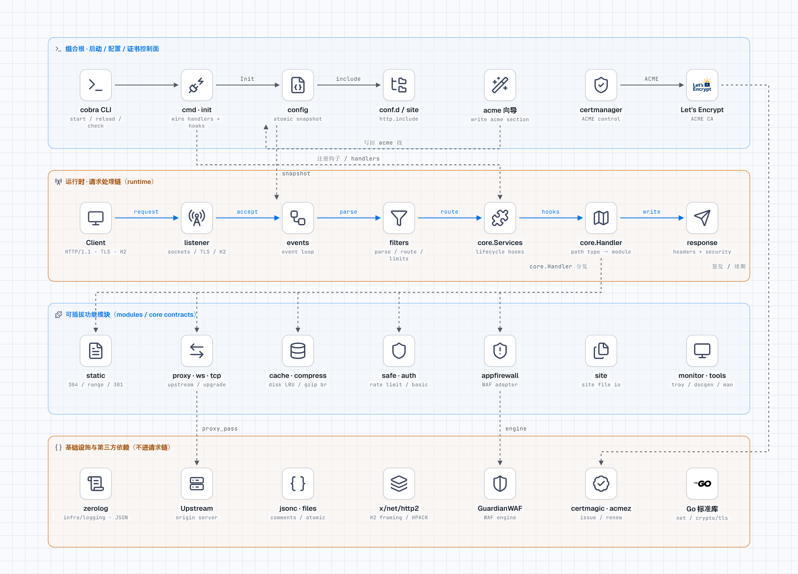

<h1 align="center">Fast-Https</h1>

<p align="center"><strong>Go 编写的轻量级 Web 服务器与反向代理：单二进制、JSON 配置、HTTP/2 与自动 HTTPS。</strong><br />
一份 JSON 描述监听端口与 location，覆盖常见的站点与反向代理场景。</p>

<p align="center">
  
  
  
  
  
  
  
</p>

<p align="center">
  
</p>

<p align="center">简体中文 | <a href="README.en.md">English</a></p>

## Fast-Https 是什么？

**Fast-Https 是一个用 Go 编写的开源 Web 服务器与反向代理。** 它自己完成端口监听、HTTP/1.1 解析和响应写出，不套用现成服务器的外壳；HTTP/2 的分帧与 HPACK 交给 `golang.org/x/net/http2`，TLS 使用 Go 标准库。

HTTPS 是自动配置的：`listen` 里写上 `443 ssl h2` 就有 HTTPS，不用提前准备任何证书——首次启动自动生成自签名证书；要受信任的正式证书时，运行 `fast-https acme` 向导接入 Let's Encrypt 等 CA，签发与到期续期全自动，签发失败回落自签名，站点始终可访问。

全部功能编译进一个可执行文件，运行时不需要额外的动态库或脚本。配置是一份允许注释的 JSON，路由按 `location` 组织，可以在 Linux、macOS 和 Windows 上运行，也可以安装为系统服务。

一条请求的处理链路：

```text
连接 → 限流 / IP 黑名单 → location 路由 → 应用防火墙 → 静态文件 / 反向代理 / TCP / WebSocket → 响应
```

## 项目架构



蓝色是请求主链，虚线是装配注入与外部依赖；分层规则与依赖约束见 [架构地图](docs/architecture-map.md)。另有可切换深色的 [交互式 HTML](docs/architecture.html) 和 [深色 PNG](docs/images/architecture-dark.png)。

## 核心能力

| 能力 | 说明 |
| --- | --- |
| 静态站点 | `root` / `index` / `try` 定位文件；`Last-Modified` 条件请求返回 304，单段 `Range` 返回 206 / 416；按 `Accept-Encoding` 协商 gzip 与 brotli；目录缺结尾斜杠时 301 到带斜杠地址；不生成目录列表 |
| 反向代理 | 每个 location 一个 `proxy_pass`，支持 `http://` 与 `https://` 上游、连接池复用、`proxy_set_header`、响应缓存、WebSocket 升级与 TCP 双向转发 |
| TLS 证书 | 每个 `server_name` 独立证书；同一 SSL 端口 `reload` 时热替换证书、不重新绑定端口；证书自动配置：缺少证书文件时启动前生成自签名证书，配置 ACME 后自动申请并续期受信任证书（Let's Encrypt 等，`fast-https acme` 向导） |
| HTTP/2 | `listen` 含 `h2` 时启用，ALPN 协商、HPACK、流状态机与流量控制由 `golang.org/x/net/http2` 处理，重载时发 GOAWAY 优雅关闭 |
| 安全 | 全局限流 + 按 location、按 IP 的令牌桶限流；IP 与 IPv6 网段黑名单；Basic 认证；GuardianWAF（sqli / xss / lfi / cmdi / xxe / ssrf，可只记录不阻断） |
| 运维 | `start` / `stop` / `reload` / `status`；热重载不断开已有连接；`start` 与 `reload` 都先校验配置 |
| 日志 | `logs/` 下 system、access、error、safe 四路 JSON 日志，每条带 `kind` 与 RFC3339 时间，重载后重新打开文件 |
| 交付 | Linux / macOS / Windows 安装包、RPM spec、三套 Docker 基础镜像；另附 Wails v3 桌面管理端（Windows 安装包） |

核心依赖（版本以 `go.mod` 为准，其余均为标准库）：

| 依赖 | 用途 |
| --- | --- |
| `spf13/cobra` | 命令行入口与子命令 |
| `rs/zerolog` | 控制台 + 系统/访问/错误/安全四路 JSON 日志 |
| `golang.org/x/net` | HTTP/2 协议栈 |
| `guardianwaf/guardianwaf` | 应用防火墙引擎 |
| `klauspost/compress`、`andybalholm/brotli` | gzip 与 brotli 压缩 |
| `caddyserver/certmagic`、`mholt/acmez/v3` | ACME 证书申请与续期（账户、订单、续期调度） |
| `charmbracelet/huh` | `fast-https acme` 的交互式配置表单 |
| `fyne.io/systray` | Windows 托盘 |

## 与通用 Web 服务器的差异

两类产品的定位不同：通用 Web 服务器覆盖的协议与模块更广，Fast-Https 把常用能力收进一个二进制、用一份 JSON 描述。下表只说明能力边界，不构成优劣评价。

| 维度 | 通用 Web 服务器 | Fast-Https |
| --- | --- | --- |
| 配置形式 | 领域专用配置文件，可拆分多份 | 单份 JSON，支持注释、尾随逗号与 `http.include` 拆分 |
| 部署形态 | 系统包安装，能力按模块启用 | 单个可执行文件，功能全部编译进二进制 |
| 静态站点 | `root` / `index` / `try` 类配置 | `root` / `index` / `try` 字段，含 304、206/416 与斜杠 301 |
| 反向代理 | 多上游、超时与缓冲指令齐全 | 每个 location 一个上游，含连接池、响应缓存与 WebSocket |
| HTTP/2 | 取决于版本与编译模块 | `listen` 加 `h2` 即启用 |
| 配置预检 | 有独立校验入口 | 不设独立子命令：`start` 预检与 `reload` 发信号前都走同一套校验，失败直接报原因 |
| 优雅停止 | 停止接受并等待在途请求 | `SIGTERM` / `SIGQUIT`，最多等 5 秒 |
| 证书热替换 | 重载配置后生效 | `reload` 在同一端口换证，不重新绑定 |
| 扩展方式 | 模块与第三方插件生态 | 内置固定功能集，不加载动态模块 |
| 多上游故障转移 | 支持多地址与健康检查 | 尚未支持，一个上游一个 `proxy_pass` |
| 应用后端协议 | 可直连 FastCGI / uWSGI / gRPC | 支持 HTTP、HTTPS、WebSocket 与 TCP 转发 |
| 运行计数 | 状态模块提供连接与请求指标 | `status` 只回答进程是否存活 |

## 适用与不适用

**适合：**

- 单机部署的静态站点、文档站、内部管理后台；
- 需要 TLS 终止与 HTTP/2、又不想维护庞大配置文件树，或没有现成证书、希望 HTTPS 零准备上线的场景；
- 把 HTTP 或 WebSocket 请求转发到本机或内网服务；
- 交付物要尽量小：一个二进制、一份 JSON、一个日志目录；
- Windows 上需要托盘或系统服务形态的轻量服务器。

**暂不适合：**

- 需要多上游负载均衡与故障转移的集群入口（R8 未实现）；
- 依赖 `rewrite` 正则、`if`、`map` 等配置表达式语言的复杂路由（`rewrite` 目前只固定返回 301）；
- 需要 FastCGI、uWSGI、SCGI、gRPC 直连后端的 PHP / Python 传统部署；
- 前置 CDN 或负载均衡、依赖真实客户端 IP 做限流或黑名单的场景（当前使用连接地址，尚无可信代理与真实 IP 还原能力）；
- 需要 HTTP/3、二进制热升级、多进程 worker 模型或运行时运行计数（`status` 只回答进程是否存活）。

## 快速开始

```bash
# 方式一：安装包
# Windows 用 dist 里的 fast-https-<version>-windows-<arch>-setup.exe 安装；
# 其他平台到 https://gitee.com/ncepu-bj/fast-https/releases 下载压缩包，解压后进入目录
./fast-https start

# 方式二：源码构建（需要 Go 1.27）
go build -o fast-https . && ./fast-https start
```

随包的配置分成两层：`config/fast-https.json` 只放系统级设置（`http.include`、`acme`、日志、WAF 等），站点一律写在 `config/conf.d/` 下，一个文件一个站点。

```json
{
  "log_root": "./logs",
  "security": {
    "host_check": "off",
    "headers": { "nosniff": true, "hsts": "", "x_frame_options": "",
                 "referrer_policy": "", "content_security_policy": "" }
  },
  "waf": { "mode": "disabled" },
  "http": {
    "include": ["./config/conf.d"],
    "default_type": "application/octet-stream",
    "servers_limit": { "max_header_size": 4096, "max_body_size": 524288, "limit": 0, "burst": 0 },
    "blaklist": [],
    "log_format": ["ip_port", "time", "type", "method", "path", "host", "status", "size", "user_agent"]
  },
  "acme": { "enabled": false, "email": "" }
}
```

以上每一项都取内置默认值，写出来只是为了让人在文件里就能看到有哪些系统级开关；字段含义见 [docs/usage.md](docs/usage.md)。

随包的 `config/conf.d/default.json` 就是开箱即用的默认站点：80 提供 HTTP，`443 ssl h2` 提供 HTTPS + HTTP/2，两者都指向 `./httpdoc/root`。443 的证书不用预置，首次 `start` 会用本地 CA 生成 `config/cert/localhost.pem` 与 `localhost-key.pem`；非 root 运行时把 `listen` 改成 `8080` 之类的高位端口。

`server_name` 支持多域名写法：空格分隔多个域名（如 `"example.com www.example.com"`），它们共享同一组 location 和证书。

```json
{
  "listen": [80, "443 ssl h2"],
  "server_name": "localhost",
  "ssl_certificate": "./config/cert/localhost.pem",
  "ssl_certificate_key": "./config/cert/localhost-key.pem",
  "location": [
    { "url": "/", "type": "local", "root": "./httpdoc/root", "index": ["index.html", "index.htm"] } ]
}
```

```bash
curl -I http://127.0.0.1/          # 期望 200 与 Server: Fast-Https
curl -kI https://127.0.0.1/        # 自签证书，-k 跳过校验
./fast-https acme                  # 需要受信任证书时，交互式打开 ACME 自动签发
```

默认配置刻意不带注释：字段含义与可选值都在 [docs/usage.md](docs/usage.md)，配置文件保持最小可读 JSON，脚本或 `acme` 向导改它时不用处理注释。需要给自己留备注时，可以照常写 `//` 注释与尾随逗号。

## 常用命令

| 命令 | 作用 |
| --- | --- |
| `./fast-https start` | 启动（无参数等同 `start`）。Linux / macOS 转后台，容器与 systemd 托管时保持前台 |
| `./fast-https stop` | 停止。Unix 发 `SIGTERM` 优雅停机，重复执行视为已停止 |
| `./fast-https reload` | 校验配置后热重载，失败保留旧配置 |
| `./fast-https status` | 读 pid 文件判断是否在运行 |
| `./fast-https version` | 打印版本号，输出一行 `fast-https <版本>` |
| `./fast-https acme` | 交互式配置 ACME 自动签发证书，写回 `acme` 段（改完需重启） |
| `./fast-https acme show` | 查看当前 ACME 配置与会申请证书的域名 |
| `./fast-https site add` | 新增站点：不带 `--domain` 时进向导，带了就用 `--listen/--root/--proxy-pass` 等参数 |
| `./fast-https site list/check/show/remove` | 站点文件的列表、校验、查看与删除 |

## 常见问题

### Fast-Https 能替代传统的 Web 服务器吗？

在单机静态站点、TLS 终止、HTTP/HTTPS 反向代理和 WebSocket 转发这几类场景里可以承担服务端角色。它没有多上游故障转移、完整 rewrite 引擎、FastCGI 与 HTTP/3，复杂网关场景需要另选方案。

### Fast-Https 支持 HTTP/2 和 HTTPS 吗？

支持。`listen` 里加 `h2` 启用 HTTP/2，加 `ssl` 启用 TLS；两者可以同时开启。HTTP/2 协议栈来自 `golang.org/x/net/http2`，TLS 来自 Go 标准库。

### 更新证书需要重启服务吗？

不需要。`reload` 会在同一个监听 socket 上换证，下一次握手即使用新证书，端口不重新绑定，已有连接不受影响。改 `acme` 段（邮箱、CA、挑战方式、续期天数）同样只需 `reload`：进程按配置差异重建证书申请任务，只有差异存在时才打断续期，`stop` + `start` 不再是必需步骤。

### Fast-Https 会自动申请受信任证书吗？

会。缺少证书文件时启动前先生成自签名证书，服务随后照常启动；配置 `acme` 段（`enabled` 与 `email`）后，进程会向 Let's Encrypt / ZeroSSL 申请受信任证书并在到期前自动续期，签发成功即在原监听 socket 上热替换。申请失败（内网、域名未解析、限速）回落自签证书并在日志告警，服务不中断。挑战只支持 `http-01` 与 `tls-alpn-01`，通配符需要 `dns-01`，仍需外部客户端。详见 [docs/usage.md](docs/usage.md) 的「7.1 ACME 自动签发」。

### 配置写错了会怎样？

`start` 与 `reload` 都会先校验配置。校验失败时 `reload` 直接返回原因，并保留旧配置与旧监听，终端上能看到具体是哪一行坏了。

### 支持 Windows 吗？

支持。提供 Windows 安装包（NSIS）、托盘程序和系统服务安装；`stop` 在 Windows 上直接终止进程，没有 Unix 的信号语义。

### 支持 WebSocket 吗？

支持。反向代理会识别升级请求并完成双向转发；TCP 类型 location 可以做纯字节转发。

### 性能如何？

Fast-Https 自己解析 HTTP/1.1、每个连接一个协程，没有 C 扩展或 worker 进程模型。仓库内没有对外发布的基准数字，压测方案与测试入口见 [docs/test/](docs/test/README.md)。

### 配置里可以用变量或条件判断吗？

不行。配置是静态 JSON 字段，`proxy_cache.key` 和 `proxy_set_header` 里的 `$变量` 只做一次性字符串替换，不是表达式求值。

## 使用文档

| 文档 | 内容 |
| --- | --- |
| [Fast-Https 产品说明（中文）](https://idealstudio-ncepu.yuque.com/kgagg7/lbeklg) | 面向部署运维：配置项、站点、证书、代理、缓存、WAF |
| [Fast-Https User Guide (English)](https://idealstudio-ncepu.yuque.com/kgagg7/rstqtx) | 同上，英文版 |
| [docs/usage.md](docs/usage.md) | 仓库内使用文档源文件，生成 `docs/usage.html` 随发行包分发 |
| [docs/feature/](docs/feature/README.md) | 按功能分篇的说明，每篇含配置示例与实现方案；另收 CLI / Monitor 的扫描报告、规范与改造计划 |
| [docs/cli/](docs/cli/command-spec.md) | 管理命令契约：字段、错误码、退出码，以及只收录实际输出示例 |
| [docs/develop/](docs/develop/README.md) | 环境构建、测试体系、代码规范、新增配置项、调试、发布 |
| [docs/help/](docs/help/README.md) | 构建与安装、装完的目录布局、常见问题排查、开发问题日志 |
| [docs/architecture.html](docs/architecture.html) | 项目架构图（[PNG](docs/images/architecture.png) / [深色 PNG](docs/images/architecture-dark.png)），分层与请求链 |
| [docs/architecture-map.md](docs/architecture-map.md) | package 盘点与依赖方向 |

文档总索引见 [docs/README.md](docs/README.md)。

## 项目结构

```text
fast-https/
├── fast-https.go        入口，调用 cmd.RootCmd()
├── cmd/                 命令行：start / dev / stop / reload / status / check / install
│                        daemon_unix.go 后台化（exec 自身），daemon_windows.go 为空实现
├── config/              配置解析、校验与热重载，fast-https.json 是唯一真源
├── init/                启动初始化：配置、日志、证书、缓存
├── core/                契约层：Event、处理器注册表、生命周期钩子
├── runtime/             数据面：监听、连接、请求/响应、过滤、热重载
├── modules/             功能包：static / proxy / proxy_tcp / websocket / cache /
│                        compress / auth / safe / appfirewall / rewrite
├── infra/               基础设施：logging / color / timeutil / banner
├── desktop/             Wails v3 桌面管理端（独立 Go module）
├── httpdoc/root/        默认站点与自签发根证书目录
├── docs/                功能、开发、测试文档
├── tests/               单元测试与端到端测试
└── build/               构建与打包：goreleaser、Dockerfile、RPM spec、NSIS、systemd unit
```

分层约定：`core` 只放契约，`runtime` 不认识 `modules`，功能包统一由 `cmd.RegisterHandlers` / `cmd.RegisterServices` 在启动时装配。细节见 [docs/develop/2-code-standards.md](docs/develop/2-code-standards.md)。

## 社区

项目已加入 [openEuler 社区](https://www.openeuler.org/)，上游代码与打包规格同时维护在社区仓库 [src-openeuler/fast-https](https://gitee.com/src-openeuler/fast-https)。

- openEuler 侧的打包与版本跟进在社区仓库进行，与安装包、spec 相关的问题和提交提到那里；
- 功能开发与缺陷修复在本仓库进行，社区仓库跟进同步上游代码；
- 使用问题先看 [docs/](docs/README.md)，仍没解决的可以在仓库 Issue 里提出。

## 更多

- 打包与发布（二进制、RPM、Docker、GoReleaser）：[docs/develop/5-release.md](docs/develop/5-release.md)
- 测试布局与运行方式：[tests/readme.md](tests/readme.md)；覆盖率与压测：[docs/test/](docs/test/README.md)
- 启动流程与信号处理：[docs/about.md](docs/about.md)
- 参与贡献：Fork 仓库 → 新建 `Feat_xxx` 分支 → 提交 → 发起 Pull Request
- 许可证 [GPL-2.0](LICENSE)
