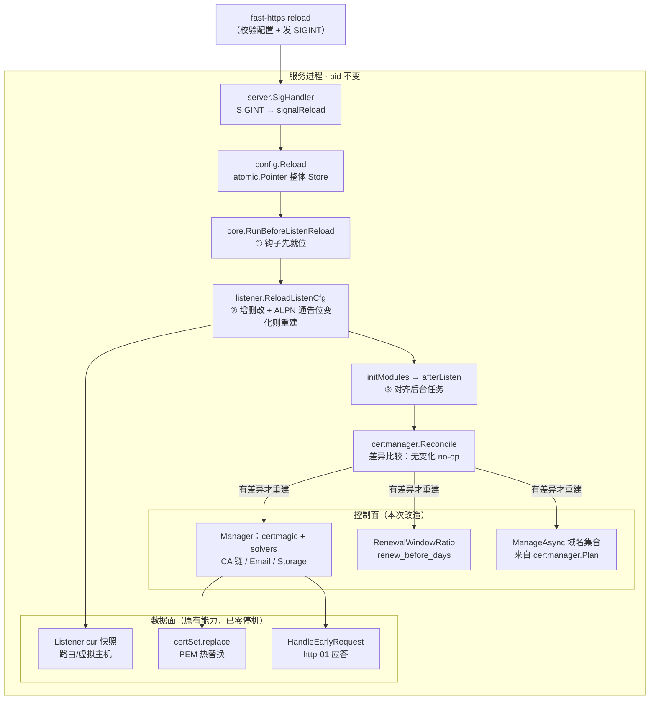
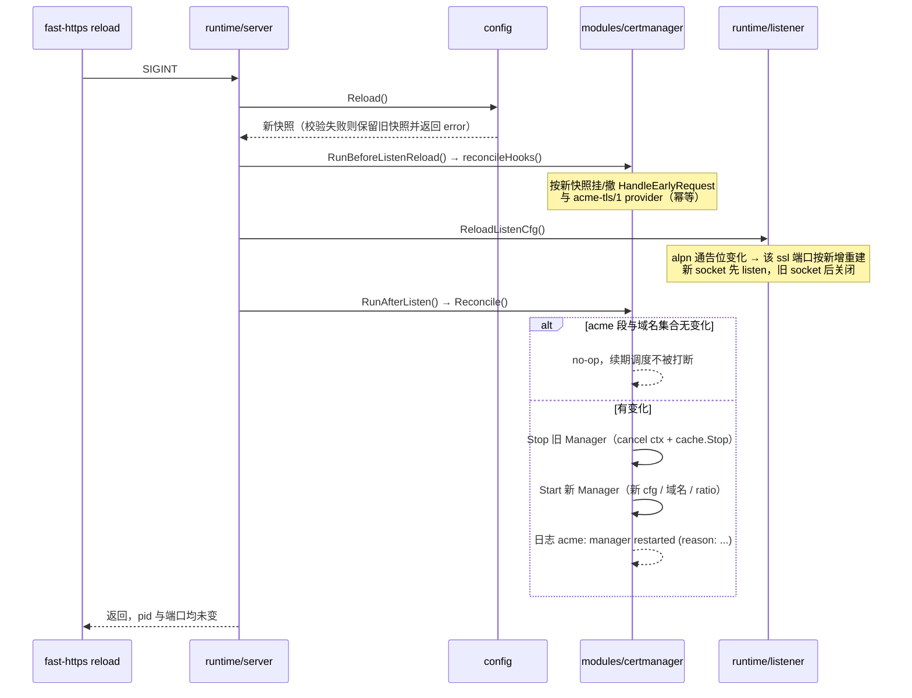

# ACME 管理器热重载计划（reload 不再需要 stop + start）

修订日期：2026-11-05。状态：**已实施**（2026-11-05，同一迭代内落地 A/B/C 三期）。

目标一句话：**把 `acme` 段从「只在启动时读取」改成「reload 时随配置快照一起对齐」，证书申请与续期这个后台任务可以被 reload 重启，而进程、端口与在途连接不动。**

## 实施结果（2026-11-05）

按期落地，与计划一致；实施中改了三处细节：

| 计划里写的 | 实际实现 | 原因 |
| --- | --- | --- |
| `certmanager.Start()` 拆出内部 `start()` | **直接删掉 `Start`**，由 `Reconcile()` 统一承担启动与对齐 | 留两个入口迟早语义漂移 |
| `Wire(*core.Services)` 保留为首次装配 | **删掉 `Wire`**，改为 `ReconcileHooks()` | `core` 改成原子指针后不再需要「先改局部结构体再整体提交」 |
| ALPN 翻转重建时「新 socket 先绑，旧 socket 后关」 | **改为先关后绑**（与类型变化同一顺序） | `ReuseCallBack` 只有 `linux && amd64` 才设 `SO_REUSEPORT`，其余平台同时绑同一端口会失败并 `Fatal`。代价是该端口有微秒级不可用窗口 |

新增测试：`modules/certmanager/manager_reconcile_test.go`、`runtime/server/reload_order_test.go`，扩展 `core/services_test.go`、`runtime/listener/alpn_test.go`。`go build ./... && go vet ./... && go test -race ./...` 全绿。

行为落点见 [../../feature/4-reload.md](../../feature/4-reload.md) 的「reload 与后台任务」一节；本节以下保留当时的规划原文。

## 1. 现状：reload 本身没有重启进程

先澄清一个常见误解。当前 `reload` 与 `stop` + `start` 是两条完全不同的路径，前者从来没有重启进程：

| 阶段 | 行为 | 位置 |
| --- | --- | --- |
| 发信号 | Windows 发 `CTRL_BREAK`/`CTRL_C`，Unix 发 `SIGINT` | `cmd/reload_windows.go:37`、`cmd/reload_other.go:12` |
| 收信号 | `SIGINT` → `signalReload`，进程不退出 | `runtime/server/server.go:113` |
| 配置 | `config.Reload()` 校验通过后整体 `Store` 新快照，失败保留旧的 | `config/config.go:205` |
| 监听器 | `ReloadListenCfg()` 增删改；同端口复用旧 `*Listener` 指针 | `runtime/listener/reload.go:120` |
| 证书 | 同端口 `old.certs.replace(cfg)` 重新读 PEM，socket 不变 | `runtime/listener/reload.go:59` |
| 模块 | `initModules()` → `core.RunAfterListen()` → `cmd.afterListen()` | `runtime/server/server.go:47`、`cmd/handlers.go:57` |

所以「配置 / MIME / 路由 / 日志 / 证书 PEM」这五样，reload 已经全部做到了零停机热替换。数据面和控制面本来就是同一个进程里的两组 goroutine，不存在两个进程之间的耦合。

## 2. 真正的缺口：三处「只在启动时做一次」

ACME 管理器（`modules/certmanager`）的生命周期没有跟着配置快照走，卡在三个点上：

| # | 位置 | 现状 | 后果 |
| --- | --- | --- | --- |
| A | `modules/certmanager/manager.go:96` | `Start()` 发现 `activeManager != nil` 直接 return（注释写明「只有第一次生效」） | reload 调到了 `Start()` 却什么也没做；旧 Manager 继续用旧 `cfg` 指针、旧域名、旧 `RenewalWindowRatio` |
| B | `cmd/handlers.go:47` | `certmanager.Wire(&services)` 只在 `RegisterServices()` 跑一次 | 启动时 ACME 关闭 → `HandleEarlyRequest` 从未挂上；reload 打开 ACME 也挂不上，http-01 永远无应答 |
| C | `runtime/listener/listener.go:440` | `acme-tls/1` 是否进 `NextProtos` 在建监听器时就定了 | reload 新注册 TLS-ALPN provider 后，旧监听器不通告 `acme-tls/1`，tls-alpn-01 必然失败 |

补充一个容易漏掉的点：`Manager.cfg` 存的是构造期的 `*config.AcmeConfig`，构造后从未被读取（`newManager` 把实际用到的字段全部展开成 solver / issuer / storage / ratio）。也就是说 ACME 段的配置是**一次性翻译**成运行期对象的，没有「读当前快照」的通道——这是 A 不能只靠「重新读一次配置」解决的根因。

另外 `certPaths()` 每次调用都读 `config.Current()`（`modules/certmanager/sync.go:22`），所以 `ssl_certificate` 路径变化本来就不需要重启管理器，会被下一次 `commit` 自然带上。

## 3. 目标架构

### 3.1 reload 全链路与 ACME 的接入位置



关键点：**钩子协调（①）必须早于监听器重载（②），管理器重启（③）必须晚于监听器重载。**

理由：`listenSsl` 在建 `tls.Config` 时读 `TLSALPNEnabled()`。如果 provider 在 ② 之后才注册，② 建出来的新监听器仍然不通告 `acme-tls/1`，白重建一次。

### 3.2 一次 reload 的时序



## 4. 设计决策

### D1 只在「运行期有影响」的差异上重启，不是每次 reload 都重启

每次 reload 都重建管理器会硬中断 certmagic 的退避队列与进行中的订单（订单作废，且可能消耗 CA 速率限制）。因此先做差异比较，`Reconcile` 的语义是「对齐」而不是「重启」。

判定函数（`modules/certmanager`）：

```go
// changed 报告两份 acme 配置对运行期是否有影响。
// 返回空串表示无变化；否则返回可直接打进日志的原因。
func changed(old *Manager, next *config.AcmeConfig, nextNames []string) string
```

比较项与原因：

| 字段 | 是否触发重启 | 原因 |
| --- | --- | --- |
| `enabled` | 是 | 开/关本身就要起停管理器 |
| `email` / `staging` / `cas` | 是 | 影响 issuer 与账户注册 |
| `storage` | 是 | `certmagic.FileStorage` 在构造期固定 |
| `challenge` | 是 | 决定注册哪些 `acmez.Solver` |
| `renew_before_days` | 是 | 只映射到 `RenewalWindowRatio`，构造期固定 |
| `fallback_self_signed` | 否 | 仅用于 CLI 文案与校验，运行期不读 |
| 域名集合（`Plan.Managed`） | 是 | `ManageAsync` 的入参 |
| `ssl_certificate` 路径 | 否 | `certPaths()` 每次读当前快照 |

为支持比较，`Manager` 需要新增 `names []string` 字段保存 `run(names)` 的入参（现在只传不存）。

### D2 重启收在 `certmanager` 内部，`server.Reload` 不感知 ACME 字段

新增两个导出函数，`cmd` 与 `runtime/server` 只按生命周期调用，不认识 `acme` 段的任何字段：

```go
// ReconcileHooks 按当前配置快照挂/撤数据面钩子。幂等，可反复调用。
// 必须在监听器重载之前调用：listenSsl 建 tls.Config 时要读 TLSALPNEnabled()。
func ReconcileHooks()

// Reconcile 按当前配置快照对齐管理器：无变化不动，有变化则先停旧再起新。
// 由 core.Services.AfterListen 在每次 reload 末尾调用。
func Reconcile()
```

`afterListen` 里的 `certmanager.Start()` 换成 `certmanager.Reconcile()`；`Wire()` 退化为「首次装配 + 设置协调钩子」，或者直接由 `ReconcileHooks()` 取代。启动与 reload 走同一条代码路径，避免两套语义漂移。

`core.Services.AfterListen` 的契约里已写明「必须幂等，reload 会再调一次」（`core/services.go:26`），`Reconcile` 正好满足。

### D3 钩子要能撤销，`core.Services` 改成可原子替换

现在 `services` 是包级值，`SetServices` 整体替换，`Wire` 拿到的是 `RegisterServices` 里的局部结构体——reload 时无法反挂 `HandleEarlyRequest`。

改法（与 `config` 包同一套风格）：

```go
var services atomic.Pointer[Services]

func SetServices(next Services) { services.Store(&next) }

// SetEarlyRequestHandler 只替换 early-request 钩子，供 reload 挂/撤 ACME 挑战应答。
// 其余钩子仍由 SetServices 一次性装配。
func SetEarlyRequestHandler(fn func(*Event) bool)
```

`RequestHandled`/`ConnRejected` 等 9 个读取函数改成 `s := services.Load()` 后取字段（`nil` 视为零值）。TLS-ALPN provider 侧已经支持传 `nil` 撤销（`runtime/listener/alpn.go:20`），无需改动。

### D4 新增 `BeforeListenReload` 钩子，解决 ①→② 的顺序约束

`runtime/server` 属于 runtime 层，不能 import `modules/certmanager`（分层守卫见 `tests/arch/layering_test.go`）。因此与既有 `AfterListen`/`AfterStop` 同构，在 `core.Services` 增一个钩子：

```go
// BeforeListenReload 在配置切换之后、监听器重载之前调用。
// 用于让数据面钩子（如 ACME 的 acme-tls/1 provider）先就位。
BeforeListenReload func()
```

`server.Reload()` 在 `listener.ReloadListenCfg()` 之前插入 `core.RunBeforeListenReload()`。

### D5 TLS-ALPN 通告位翻转时重建该 ssl 监听器

`tls.Config.NextProtos` 是建监听器时的静态切片，无法原地改。两种选择：

| 方案 | 做法 | 取舍 |
| --- | --- | --- |
| 常驻通告 | `NextProtos` 永远带 `acme-tls/1` | 零重建，但推翻 `listener.go:438` 的既有承诺「未启用 ACME 的握手表与之前完全一致」，且所有部署都多一个 ALPN 项 |
| **按需重建**（采用） | 只在开关翻转时重建该端口 | 保持既有握手语义；复用已验证过的 typeChanged 路径 |

实现方式不新增代码路径，只扩展 `updateCommonToNewLinster` 的判定：

- `Listener` 增加字段 `alpnACMESnapshot bool`，在建 `Lfd` 的同一步记录当时的 `TLSALPNEnabled()`；
- 判定条件从 `old.LisType != each.LisType` 扩展为 `old.LisType != each.LisType || old.alpnACMESnapshot != TLSALPNEnabled()`；
- 命中后走既有「类型变化」分支：新建 `certSet` + `listenSsl` + 新 `Ctx/Cancel` + `publish()`，端口追加进 `removed` 由 `server.Reload` 关闭旧 socket。

计划里曾判断这条路径没有端口空窗（先绑新 socket 再关旧的）。**实施时改为先关后绑**：`SO_REUSEPORT` 只在 `linux && amd64` 设置，其余平台同时绑同一端口会失败，详见开头「实施结果」。因此该端口有一次 close+bind 的微秒级窗口，在途连接不受影响。

### D6 并发与顺序

- `Reconcile` 与进程退出的 `Stop()` 用现有的 `startMu` 串行化；
- 一律「先 `activeManager.Swap` 再 `stop` 旧实例」，与 `Stop()` 现有写法一致，读侧（`handleEarlyRequest`/`tlsALPNChallengeCert`）永远拿到未停止的对象或 `nil`；
- `Manager.stop()` 已有 `sync.Once` 保证幂等，重复 Stop 安全。

## 5. 改动清单

| 文件 | 改动 | 规模 |
| --- | --- | --- |
| `core/services.go` | `services` 改 `atomic.Pointer[Services]`；新增 `SetEarlyRequestHandler`、`BeforeListenReload` 字段与 `RunBeforeListenReload()`；9 个读取函数改 Load | ~40 行 |
| `modules/certmanager/manager.go` | `Manager.names`；`Reconcile()`、`ReconcileHooks()`、`changed()`；`Start` 拆出内部 `start()`；`Wire` 并入 `ReconcileHooks` | ~90 行 |
| `cmd/handlers.go` | `RegisterServices` 挂 `BeforeListenReload: certmanager.ReconcileHooks`；`afterListen` 里 `Start()` → `Reconcile()` | ~5 行 |
| `runtime/server/server.go` | `Reload()` 里 `ReloadListenCfg()` 之前插 `core.RunBeforeListenReload()` | ~3 行 |
| `runtime/listener/listener.go` | `Listener.alpnACMESnapshot` 字段 + 建 `Lfd` 时记录 | ~5 行 |
| `runtime/listener/reload.go` | `updateCommonToNewLinster` 的判定加 alpn 通告位 | ~8 行 |
| `cmd/acme.go` | 删掉「请重启」提示（`501-503`）与「reload 不会重建」文案（`64`、`68`） | ~6 行 |
| 测试 | 见第 7 节 | 新增 3 个文件 + 扩展 3 个 |
| 文档 | 本文 + `docs/feature/4-reload.md`、`docs/feature/3-tls-certs.md`、`docs/develop/README.md` | — |

## 6. 分期

| 阶段 | 内容 | 完成后的语义 |
| --- | --- | --- |
| **A** | `core` 钩子可替换 + `certmanager.Reconcile`/`ReconcileHooks` + `afterListen` 改调用 + 单测 | 改 `acme` 段 + reload 生效；启动时已启用 tls-alpn-01 的前提下 ALPN 也正常 |
| **B** | `BeforeListenReload` + listener 的 alpn 翻转重建 + 顺序测试 | 启动时关闭 ACME，reload 打开后两条挑战都可用（完整语义） |
| **C** | CLI 文案、`docs/feature/*` 与索引同步、E2E 扩展 | 用户可以只 reload 不重启 |

A 与 B 都完成才算功能闭环；A 单独上线会让「reload 打开 ACME」处于半可用状态（http-01 可用、tls-alpn-01 不可用），所以建议 A+B 一起合入。

## 7. 测试计划

| 测试 | 覆盖 |
| --- | --- |
| `modules/certmanager/manager_reconcile_test.go`（新） | 相同配置 → `activeManager` 指针不变；改 `renew_before_days`/`email`/`storage`/`challenge`/域名集合 → 指针变且旧 ctx 被取消；`enabled: true→false` → 管理器变 `nil` 且 `HandleEarlyRequest` 被撤销；`false→true` → 钩子挂上并启动 |
| `core/services_test.go`（扩） | `-race` 下 `SetEarlyRequestHandler` 与 `RequestHandled` 并发；`nil` 钩子的零值语义 |
| `runtime/listener/alpn_test.go`（扩） | `alpnACMESnapshot` 与 `TLSALPNEnabled()` 不一致时 `ReloadListenCfg` 判为需重建；一致时不重建（旧 `*Listener` 指针保持） |
| `runtime/server/reload_cert_test.go`（扩） | `BeforeListenReload` 一定早于 `ReloadListenCfg` 被调用（打点顺序断言） |
| `tests/client_test/reload_e2e_test.go`（扩） | reload 前后 pid 一致、并发请求零失败、日志出现重启与新配置生效 |
| 全量 | `go build ./... && go vet ./... && go test -race ./...`（29 包） |

## 8. 验收标准

1. `fast-https status` 前后 pid 相同；只改 `acme.renew_before_days` 后 `fast-https reload`，日志出现 `acme: manager restarted (reason: renew_before_days)`，`fast-https acme show` 显示新值。
2. 只改非 `acme` 配置（例如 `log_root`）后 reload，日志**不出现**重启行，管理器指针不变。
3. 启动时 `acme.enabled=false`，reload 打开并配好域名 → 日志出现首次申请，`/.well-known/acme-challenge/<token>` 与 `acme-tls/1` 都能应答。
4. reload 关闭 ACME → 挑战路径回到正常路由（404）、`acme-tls/1` 不再通告。
5. 上述过程中端口无中断：E2E 并发请求零失败。

## 9. 风险与回滚

| 风险 | 影响 | 缓解 |
| --- | --- | --- |
| 重启窗口内 token 表为空（旧管理器已停、新的 `Present` 未写入） | 恰好此刻 CA 来验证会失败一次 | certmagic 自带重试；窗口是毫秒级；日志记录重启原因便于排查 |
| 频繁 reload 消耗 CA 速率限制 | 申请被限流 | 差异比较 + 不做无条件重启；不引入自动 watch（见第 10 节） |
| `cache.Stop()` 与进行中的 `ManageAsync` 需确认不开死锁 | reload 卡住 | `-race` 下反复 Restart 压测；必要时先 `cancel()` 并等待后台协程退出（`Manager` 加 `done chan struct{}`） |
| 重建监听器与 `serveListener` 的 `lis.Lfd` 读写竞争 | data race | 不走「原地替换 `Lfd`」，复用既有 typeChanged 的「移除 + 新增」路径（替换 `*Listener` 而非字段） |

回滚：改动集中在 `certmanager`、`core` 与两处一行调用。若线上有问题，把 `afterListen` 恢复成 `certmanager.Start()`、去掉 `RunBeforeListenReload` 调用即回到当前行为（`Reconcile` 与钩子协调保留也无副作用）。

## 10. 范围外（不在本计划内）

- **不做**配置文件自动监听重载：那是 [config-autoreload-plan.md](../plans/config-autoreload-plan.md)（R7）的范围。本文只定义 reload 被触发之后「要做什么」。
- **不做**域名集合的增量管理（`ManageAsync(新增)` + 单独处理移除）：重建更简单，「停止申请某个域名」在增量模型里很容易漏。
- **不做** reload 防抖/合并：等真实出现 reload 风暴再说，避免引入额外状态。
- **不做** DNS-01 与通配符：与本文无关。
