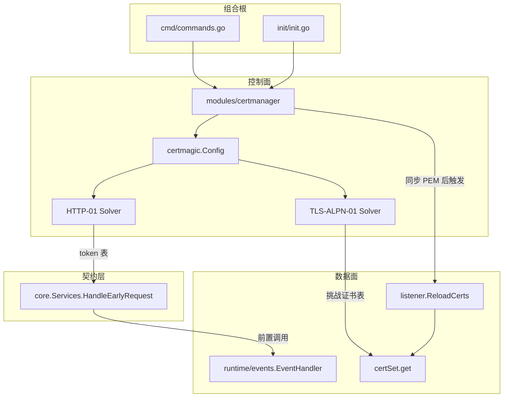

# ACME 自动签发与续期计划（certmagic 取代 shell/.acme.sh）

修订日期：2026-10-30。状态：**仅规划，未实施**，等后续迭代再启动。

本文记录一项推迟的证书链路改造：让 fast-https 自己能向 Let's Encrypt 等 ACME CA 申请与续期证书，取代仓库内 `shell/.acme.sh` 脚本，不再依赖外部脚本写 PEM。本文只写方案与验收口径，**尚未引入任何依赖、未改任何代码**。

## 1. 现状与问题

| 项 | 现状 | 问题 |
| --- | --- | --- |
| 证书来源 | `init/autocert.go` 的 `CertInit` 生成本地 CA 与自签证书 | 浏览器不信任，公网站点必须换受信任证书 |
| 外部签发 | `shell/.acme.sh/` 脚本由人工执行，把 PEM 写回 `config/cert/` | 依赖外部工具与人工步骤，续期靠人记；脚本与二进制版本各自漂移 |
| 续期 | 无 | 证书过期只能等故障暴露 |
| 热替换 | `listener.ReloadCerts` 不存在；只有 `reload` 命令会重载监听与证书 | 换证要么手工 `reload`，要么重启，端口有中断 |

目标：服务启动后仍可正常自签起服务；配置开启 ACME 后，后台为每个 `server_name` 申请受信任证书，成功后自动替换正在使用的证书，监听端口不中断；续期在到期前自动完成。申请失败（内网、域名未解析、速率限制）回落自签，服务照常运行，只在日志里告警。

## 2. 技术栈与边界

| 项 | 选择 | 说明 |
| --- | --- | --- |
| ACME 客户端 | `github.com/caddyserver/certmagic`（依赖 `github.com/mholt/acmez/v3`） | 账户、订单、续期调度、存储由它负责 |
| 存储 | `certmagic.FileStorage` 指向 `config/cert/acme/` | 与现有 PEM 同目录但不冲突，便于备份 |
| 挑战 | 自定义 `acmez.Solver`（HTTP-01 / TLS-ALPN-01） | 数据面是自研 HTTP/1.1 解析器，不能用 certmagic 的 `http.Handler`，必须自己实现 solver 把 token 交给数据面 |
| 装配 | 组合根 `cmd` + `init` | 符合现有分层守卫 |

模块路径变更记录：计划里写的 `github.com/mholt/certmagic` 已改名为 `github.com/caddyserver/certmagic`，`@latest`（v0.25.6）声明的模块路径是后者，`go get github.com/mholt/certmagic` 会因路径不符失败。实施时按 `github.com/caddyserver/certmagic` 引入，import 路径同步。

新增依赖后需实测二进制增长：certmagic 的 `dnsprovider.go` 引用 `go-acme/lego/v4`，即使不做 DNS-01 也可能被链入，届时要给出裁剪结论（记录在 [5-release.md](../5-release.md)）。

## 3. 核心判断：挑战拆成「编排」与「应答」

- **编排**放控制面：账户注册、订单、续期调度、失败重试、证书同步、事件通知。
- **应答**放数据面薄钩子：HTTP-01 的 token 路径响应、TLS-ALPN-01 的握手证书。

理由：应答必须占用监听端口与 TLS 握手。若控制面自己开 80 端口或改 TLS 配置，等于在控制面里再造一个 listener，还会与数据面的端口管理冲突。certmagic 本身也是这个切分（`certmagic.Config` 管编排，挑战应答交给 HTTP/TLS 服务端回调）。

### 3.1 分层落点（不破坏 [layering_test.go](../../../tests/arch/layering_test.go)）

| 层 | 包 | 职责 |
| --- | --- | --- |
| 契约层 | `core` | `Services` 新增 `HandleEarlyRequest func(*Event) bool`，在 location 匹配之前被调用 |
| 数据面 | `runtime/events` | `EventHandler` 开头调用 `core.RequestHandled(ev)`，命中即返回 |
| 数据面 | `runtime/listener` | 导出 `RegisterTLSALPNProvider(fn)`；`certSet.get` 先判 ALPN；`NextProtos` 追加 `acme-tls/1`；导出 `ReloadCerts()` |
| 控制面 | `modules/certmanager`（新增） | certmagic 实例、两个 solver、证书同步、续期调度 |
| 配置 | `config` | 顶层 `acme` 段：schema、默认值、校验、绝对路径 |
| 组合根 | `cmd`、`init` | 注入 `core.SetServices` 的钩子、注册 ALPN provider、启动 manager |

关键约束：`core` 已依赖 `runtime/listener`（`Event` 里持有 `*listener.Listener`），所以 `runtime/listener` **不能** import `core`。ALPN 钩子因此不走 core，而是在 `listener` 包内定义注册函数，由 `modules/certmanager`（允许依赖 `runtime/listener`）或组合根注入。

## 4. 两条挑战的应答实现

### 4.1 HTTP-01

- `modules/certmanager` 的 solver `Present` 把 `token → keyAuthorization` 写入内存表（`sync.Map`）。
- `core.Services.HandleEarlyRequest` 实现体：解析 `ev.RR.Req.Path`（注意 `Request.Path` 仍带 query，需先按 `?` 切），匹配 `/.well-known/acme-challenge/<token>` 且在表内，写 `200 text/plain` 并返回 true。
- `events.EventHandler` 在 `fif.Fif.RequestFilter(ev)` 之前调用该钩子，避免挑战请求依赖站点路由（站点根可能不含 challenge 目录）。
- 未启用 ACME 时钩子为 nil，开销是一次判空。

### 4.2 TLS-ALPN-01

- solver `Present` 用 `acmez.TLSALPN01ChallengeCert(token, identifier)` 生成临时证书，写入 `listener` 的 ALPN 表（按 SNI 建 `map[string]*tls.Certificate`，用 `atomic.Pointer` 整体替换）。
- `certSet.get` 开头：若 `hello.SupportedProtos` 含 `acme-tls/1`，先查 ALPN 表，命中直接返回；未命中回落正常证书。
- `listenSsl` 的 `tlsConfig.NextProtos` 在原有 `h2`/`http/1.1` 之后追加 `acme-tls/1`，保证协商得到。注意 `runtime/listener/alpn_test.go` 已锁定「不含 h2 的 ssl 端口不通告 h2」，追加时不能顺手把 `h2` 带给纯 ssl 端口。

## 5. 启动与证书生命周期

```
PreCheckHandler: config.Init() → CertInit()（自签兜底，保证文件存在）→ CheckConfig() → ScanPorts()
→ 监听建立 → core.RunAfterListen()
→ certmanager.Start()：对每个 ssl server_name 异步 certmagic.ManageAsync
→ 成功：storage 中的 <domain>.crt/.key 原子写回 config/cert/<server_name>.pem 与 -key.pem
→ 调用 listener.ReloadCerts()，内部对每个 ssl listener 执行 certs.replace(lis.Cfg)
→ 失败：保留自签证书，按退避重试，日志告警
```

`certmagic` 的自动续期由 `ManageAsync` 的后台任务承担（到期前按 `renew_before_days`，默认 30 天），落盘回调仍走上述「同步 + ReloadCerts」路径。`CertInit` 只在文件不存在时生成，因此 ACME 写入后不会被自签覆盖。

`ReloadCerts` 与 `ReloadListenCfg` 的分工：前者只重读证书文件、socket 与配置快照都不动；后者才是 `reload` 命令的端口差量热更新。

## 6. 配置设计（顶层 `acme`，snake_case 与现有字段一致）

| 字段 | 默认 | 说明 |
| --- | --- | --- |
| `enabled` | `false` | 总开关，默认关闭保证老配置零变化 |
| `email` | 空 | 账户邮箱；`enabled` 为真但为空时告警并禁用 |
| `directory` | Let's Encrypt v2 | 可指向 staging 便于联调 |
| `challenge` | `["tls-alpn-01","http-01"]` | 优先级列表，只接受这两个值 |
| `renew_before_days` | 30 | 续期提前量 |
| `fallback_self_signed` | `true` | 失败回落自签（已确认保留回落） |
| `storage` | `config/cert/acme` | 可选覆盖，默认由常量给出 |

校验规则：

- `challenge` 含非法值报错。
- `enabled` 为真且 `email` 为空：`check` 报错（避免运行时才发现账户无法注册）。
- `challenge` 含 `http-01` 但没有任何 `listen` 为 80 的 server：`check` 只给警告（前面可能有反代转发 80），不阻断。
- `server_name` 是 IP、`localhost` 或通配符（`*.`）时跳过 ACME 并告警（通配符只能 DNS-01）。

## 7. 实现要点（避免返工）

- **握手热路径**：`certSet.get` 只多一次 slice 判 ALPN + 一次 `atomic.Pointer.Load`，不引入锁竞争；ALPN 表为空时走原逻辑。
- **写入原子性**：证书同步先写 `<name>.pem.tmp` 再 `os.Rename`，避免数据面 `loadCerts` 读到半截 PEM（`replace` 失败会保留旧证书，已有 [cert_reload_test.go](../../../runtime/listener/cert_reload_test.go) 覆盖）。
- **日志**：certmagic 的 `Logger` 适配到 `infra/logging`，禁止打印账户私钥与完整证书链；申请失败按次数退避，避免速率限制下刷屏。
- **Blast radius**：`acme.enabled` 默认 false，除新增包与两个钩子外不改动现有请求路径；`shell/.acme.sh` 零引用，删除不影响构建与打包。
- **打包**：`nfpms.contents` 需补 `config/cert/acme/.keep` 占位，保证非 systemd 手工启动时也能写账户与证书缓存。

## 8. 架构设计



## 9. 改造清单

```
fast-https/
├── config/
│   ├── acme.go                    # [NEW] AcmeConfig 结构、默认值、校验、存储目录绝对化
│   ├── acme_test.go               # [NEW] 默认值、非法 challenge、空邮箱、相对路径绝对化
│   ├── config.go                  # [MODIFY] jsonConfig 增加 acme 字段并接入 convert/SetDefault/ValidateConfigFile
│   ├── consts.go                  # [MODIFY] 增加 ACME 存储目录常量（基于 FAST_HTTPS_BASE_DIR 与 CERT_DIR）
│   └── fast-https.json            # [MODIFY] 增加 acme 段示例，enabled=false
├── core/
│   └── services.go                # [MODIFY] Services 增加 HandleEarlyRequest；新增 RequestHandled(ev) 调用入口
├── runtime/
│   ├── events/events.go           # [MODIFY] EventHandler 在 RequestFilter 之前调用 core.RequestHandled
│   └── listener/
│       ├── alpn.go                # [NEW] ALPN 挑战证书注册表（atomic.Pointer 整体替换）+ 查询函数
│       ├── alpn_test.go           # [NEW] 注册后按 SNI 命中、未注册/未带 ALPN 时回落
│       ├── certs.go               # [MODIFY] get() 先判 acme-tls/1 并查表
│       ├── listener.go            # [MODIFY] listenSsl 的 NextProtos 追加 acme-tls/1
│       └── reload.go              # [MODIFY] 导出 ReloadCerts()：遍历 GLisinfos 对 ssl listener 执行 replace
├── modules/certmanager/
│   ├── manager.go                 # [NEW] certmagic 实例、ManageAsync 调度、失败退避与告警、生命周期 Start/Stop
│   ├── solver_http01.go           # [NEW] acmez.Solver 实现 + token 表 + HandleEarlyRequest 响应体
│   ├── solver_tlsalpn01.go        # [NEW] acmez.Solver 实现 + 临时证书生成与注册
│   ├── sync.go                    # [NEW] storage → config/cert/<name>.pem 原子同步 + 触发 ReloadCerts
│   ├── manager_test.go            # [NEW] 域名筛选（跳过 IP/localhost/通配符）、失败回落判定
│   └── solver_test.go             # [NEW] Present/CleanUp 写表与清表、HTTP 响应码与 body、ALPN 证书匹配
├── cmd/commands.go                # [MODIFY] 装配 certmanager 与两个钩子；ACME 失败只告警
├── init/init.go                   # [MODIFY] InitSystem 中在 CertInit 之后启动 certmanager
├── build/goreleaser.yaml          # [MODIFY] nfpms.contents 增加 config/cert/acme/.keep
├── docs/
│   ├── usage.md                   # [MODIFY] 删除"不自动续期/外部签发用 acme.sh"，改为 ACME 配置说明与回落行为
│   ├── usage.html                 # [MODIFY] 由 go run ./tools/docgen 重新生成
│   ├── feature/3-tls-certs.md     # [MODIFY] 补 ACME 链路：solver → 数据面钩子 → 热替换
│   ├── nginx-core-gap.md          # [MODIFY] "证书自动申请"从"暂缓"改为已支持，注明仅 HTTP-01/TLS-ALPN-01
│   └── architecture-map.md        # [MODIFY] 增加 modules/certmanager 行与控制面/数据面边界
├── .dockerignore                  # [MODIFY] 去掉 shell 条目
└── shell/.acme.sh/                # [DELETE] 整体移除
```

## 10. 关键代码结构

```go
// core/services.go：新增的前置请求钩子
type Services struct {
    // ... 现有字段
    // HandleEarlyRequest 在 location 匹配之前处理保留路径（如 ACME 挑战）。
    // 返回 true 表示已经写好响应，请求不再进入路由。
    HandleEarlyRequest func(*Event) bool
}

// runtime/listener/alpn.go：数据面挑战证书注入点
// RegisterTLSALPNProvider 注册 TLS-ALPN-01 挑战证书来源，传 nil 表示撤销。
func RegisterTLSALPNProvider(fn func(hello *tls.ClientHelloInfo) (*tls.Certificate, bool))

// runtime/listener/reload.go
// ReloadCerts 重新读取所有 ssl listener 的证书文件，监听 socket 保持不变。
func ReloadCerts() error
```

## 11. 测试与验收

| 项 | 验收标准 |
| --- | --- |
| 配置 | `acme` 缺省时行为与现在完全一致；非法 `challenge`、空 `email`、相对 `storage` 各有单测 |
| HTTP-01 | `Present` 后 token 表可查、`CleanUp` 清空；`events` 层对 `/.well-known/acme-challenge/<token>` 返回 200 与正确 keyAuth；未知 token 返回 404 |
| TLS-ALPN-01 | 客户端带 `acme-tls/1` 且 SNI 命中时返回挑战证书；未命中回落正常证书；`h2`/`http1.1` 通告不被破坏 |
| 热替换 | 覆盖 PEM 后调用 `ReloadCerts`，同一监听 socket 换证成功（复用 `cert_reload_test.go` 模式） |
| 回落 | 关网/错误 CA 时服务仍以自签证书启动，日志有告警，不重复刷屏 |
| 分层 | `go test ./tests/arch/` 通过，`modules/certmanager` 不依赖 `runtime/server`、`events`、`filters` |
| 回归 | `go build ./... && go vet ./... && go test -race ./...` 全绿 |
| 体积 | 记录引入前后 `go build -o fast-https .` 的体积差；若 lego 被链入需给出裁剪结论 |
| 打包 | `goreleaser release --snapshot` 后 deb 内含 `config/cert/acme/.keep`，装完 `systemctl start` 能正常申请或回落 |

## 12. 实施顺序（建议拆成可独立提交的 6 步）

1. 引入依赖，新增 `config/acme.go` 并在 `jsonConfig`、`SetDefault`、`ValidateConfigFile` 接入，补配置单测。
2. 数据面钩子：`core.Services.HandleEarlyRequest`、`listener` 的 ALPN 注册表与 `get` 分支、`NextProtos`、`ReloadCerts`（先写测试）。
3. 新增 `modules/certmanager`：certmagic 实例、两个 solver、PEM 原子同步、异步申请与续期。
4. 在 `cmd` 与 `init` 装配钩子与 manager，保持 `CertInit` 自签兜底优先，ACME 失败只告警。
5. 删除 `shell/.acme.sh`，同步 `usage.md`/`usage.html`、`feature/3-tls-certs.md`、`nginx-core-gap.md`、`architecture-map.md`、`.dockerignore`。
6. 验收：分层守卫、`-race` 全量测试、二进制体积对比与 `goreleaser` 打包冒烟。
