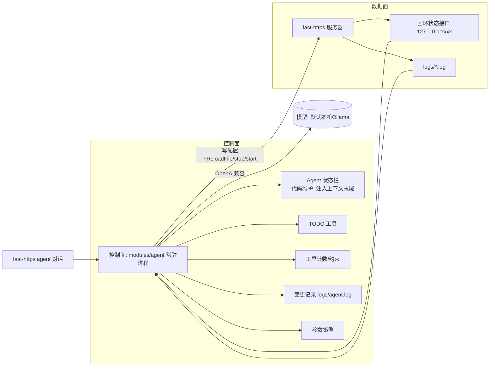

# fast-https Agent 化改造方案（2.0 实施计划）

> 定位：本文只讲**怎么改、分几步、验收什么**，不写代码。
> 设计本身以 [product-design-2.0.md](../../product-design-2.0.md) 为准，本文是它的**落地改造计划**，并补上该设计稿缺失的 **Agent 状态栏**（依据 `agent-status-design` 技能）。
>
> 已确认决策（2026-10-14，来自需求澄清）：
> - **目标**：落地 2.0 常驻智能体控制面 = 数据面可观测 + `agent` 常驻进程 + 多轮对话/快环/慢环 + Agent 状态栏。
> - **模型**：默认本机 Ollama（`http://127.0.0.1:11434/v1`），远程 OpenAI 兼容接口可选；**使用远程时，脱敏必须先于第一次调用**。
> - **本文件独立成篇**，`product-design-2.0.md` 保持纯设计，不被实施细节污染。

---

## 1. 现状与缺口（带证据）

**代码现状（V1.3.2）**

- 全仓检索 `状态栏|StatusBar|status_bar|agent|Agent` 在生产代码 **0 命中**：没有控制面、没有统一计数器出口、没有 LLM 接入。fast-https 目前是纯**数据面** Web 服务器。
- 配置加载、校验、热重载已就绪：`config.LoadFile/ReloadFile`（校验失败回退上一份 `GConfig`）、`config.ValidateConfigFile`（含 `conf.d` include 校验）、`cmd` 的 `start/stop/reload/status/check` 子命令（cobra）。
- 唯一的"状态指示"是 `monitor/windows.go` 的托盘图标（服务在/不在），与 Agent 状态栏无关。

**2.0 设计稿已覆盖**：控制面/数据面分离（§2）、`fast-https agent` 常驻进程、多轮对话（§3）、快环/慢环（§4）、冷门启停（§5）、服务端状态接口（§6）、参数分级（§8）、`config/agent.json`（§9）、变更记录（§10）、失败安全（§11）、分期 P1–P5（§12）。

**关键缺口**：设计稿把**服务端状态**设计得很全，但**没有"Agent 状态栏"**——即注入到 LLM 上下文末尾的结构化状态层（工具调用计数、TODO、环境摘要、错误摘要、原始诉求）。这是"符合 agent 开发"最该补的一块，也是本方案第 4 节的重点。

---

## 2. 借用 `agent-status-design` 的评测（"瞥一眼检验"）

把 2.0 的常驻智能体单独抽出来，对照状态栏必须能答的 5 个问题：

| # | 问题 | 2.0 设计现状 | 结论 |
| --- | --- | --- | --- |
| 1 | 工具调用几次？是否达上限？ | 未定义 agent 工具计数与上限 | **缺失** |
| 2 | TODO 剩几项？当前在哪？ | §4 有闭环步骤，但无可操纵的 TODO 工具 | **缺失** |
| 3 | 现在几点/工作目录/什么系统？ | §3.2 有平台基目录，但是静态写法，非动态注入 | **部分** |
| 4 | 上次为什么失败？怎么修？ | §11 覆盖服务端失败，无 agent 侧四层错误格式 | **部分** |
| 5 | 用户原始诉求是什么？ | §3 会话记住已确认端口/目录/上游，接近但未作为状态字段 | **部分** |

**评测结论**：服务端可观测（§6）设计充分；**Agent 上下文状态栏基本空白**。补法见第 4 节，其中第 1、2 项（计数/TODO）是硬缺口，3/4/5 需要固化为注入字段。

---

## 3. 目标架构（控制面 / 数据面分离）

原则（对齐 2.0 §1.2/§2）：

- **请求处理路径不调用模型**；模型只在控制面（慢环/对话）被调用。
- **只有一个控制面入口**（`fast-https agent` 常驻进程）改配置，避免两个入口同时写同一份 JSON。
- **状态栏由代码计算**，不让 LLM 自己统计（skill 硬约束）。

---

## 4. Agent 状态栏设计（本次改造的核心新增）

> 目标：模型**不扫描原始轨迹**就能答出第 2 节的 5 个问题。以下按 `agent-status-design` 交付物逐条落地。

### 4.1 状态字段字典（注入内容）

| 字段 | 含义 | 数据来源（受控） | 更新时机 |
| --- | --- | --- | --- |
| `original_goal` | 用户本轮/本会话的原始诉求 | 对话状态机（§3 记住的端口/目录/上游） | 每轮 |
| `todo` | 当前任务清单（ID/内容/状态） | TODO 存储（§4.3） | 变更时 |
| `tool_calls` | 各工具已用次数 / 上限 | 计数器（§4.2） | 每次工具返回 |
| `env` | 工作目录(基目录)、OS、Shell、系统时间 | 运行时 + 2.0 §3.2 平台表 | 每轮；`cd`/reload 后刷新 |
| `server` | 进程在否、pid、监听端口、协议标记 | 回环状态接口（§6） | 每轮/启停后 |
| `last_error` | 上次操作失败：类型+参数+栈+修复建议 | 本地错误封装（§4.6） | 出错时 |
| `pending` | 待生效配置是否存在、冷门判定状态 | 待生效队列 + 冷门模块 | 变更时 |
| `policy_budget` | 策略内可改键的 当前值/上下限/冷却 | 参数策略（§8） | 变更时 |

只放**决策真正依赖**的元信息，避免状态栏膨胀成上下文负担。

### 4.2 工具调用计数与约束

- **计数在工具返回结果里直接标注**（如「本次是第 N 次调用 `reload`」），让模型看到计数即触发模式识别，而不是只写在系统提示词里。
- 约束以 `已用/上限` 形式显式写出（`已达上限 (3/3)`），超限有明确禁止动作；上限与"超限后拒绝还是降级"属业务决策，默认**拒绝并说明**（待 §13 定稿）。
- 计数维度默认**按工具分组**（reload/写配置/stop/start/查询各一计数），而非一律全局。

### 4.3 TODO 结构与两个工具

- 状态枚举：`pending / in_progress / completed / cancelled`；每项含唯一 ID、内容、时间戳。
- 提供 `rewrite_todo_list` 与 `update_todo_status` 两个工具，通过"复述"操纵注意力（skill 参考实现见技能资产）。
- 用途：把一次部署/调参拆成子任务，缓解长上下文下的子任务遗漏。

### 4.4 侧信道信息（随事件追加）

- 用户消息与工具响应加时间戳前缀 `[2026-10-14 10:30:45]`，帮助模型理解时序；**时间戳不写进 system 提示词**。

### 4.5 环境观察摘要

- 至少含：系统时间、工作目录（= 编译布局基目录，2.0 §3.2）、OS、Shell。
- **工作目录随 `cd`/reload 自动更新**；OS 信息让模型做平台相关决策（路径写法见 §3.2 表）。

### 4.6 详细错误格式（四层）

1. 类型与描述；2. 完整参数 JSON；3. 调用栈/来源（如 `logs/error.log` 尾部行）；4. 针对性修复建议。
- 例：`ReloadFile 校验失败` → 建议"检查 location[].root 是否存在、listen 端口是否占用、查看 logs/system.log 尾部"。把 2.0 §11 的失败表映射为可执行修复建议。

### 4.7 注入位置与消息结构

- 在**消息拼装层**把状态栏作为**一条 `user` 角色消息插入到上下文末尾**，用 `<agent_status> ... </agent_status>` 包裹，标明是框架生成的元信息而非真实用户输入。
- **不修改 system 消息**（否则破坏 KV Cache 前缀）。
- 落点：`modules/agent` 组装 OpenAI 兼容请求处。

### 4.8 更新策略（替换 vs 追加）

- 默认**每轮替换**（上下文永远只有一份最新状态，简单且不会累积陈旧状态）；代价是使上次注入后的后缀缓存失效（通常只影响一轮）。
- 备选**持久追加**（对缓存完全友好，但陈旧状态累积、占 token）。二选一用 `agent-status-design` 的 `cache_cost_estimator` 按 `S/R/N/α` 测算分界点后定稿。
- **α、模型缓存命中规则、S/R/N 需在实现时查服务商文档 + 实测，本文不拍脑袋给数**（见第 8 节假设）。

### 4.9 维护纪律与投毒防护

- 计数、阈值比对、TODO 状态机**全部由代码维护**；确需 LLM 时逐条抽取后代码汇总，绝不让它一次性批量统计。
- 状态字段**只来自受控数据源**（计数器、状态接口、错误封装），禁止把用户输入/日志原文直接拼进状态字段（防投毒：模型几乎无条件相信状态栏）。
- 状态栏是有损投影：**未确认覆盖所需全部维度前，不整段删除原始上下文**。

### 4.10 审计日志

- 每次注入前把状态快照 + 来源落盘（可按轮次回放），用于排查"模型为什么这么决策"。

---

## 5. 改造分期（对齐 2.0 P1–P5）

| 阶段 | 对应 | 内容 | 验收标准 |
| --- | --- | --- | --- |
| **A 数据面可观测** | P1 | 在接受连接/写响应/限流拒绝路径加计数器（活动连接、接受/完成请求、4xx/5xx、限流拒绝）；暴露只绑 `127.0.0.1` 的状态接口（pid、启动时间、配置路径、每端口协议+活动连接、最近 60s 计数、最近 reload/启停结果、待生效存在性） | 能读到连接数、4xx/5xx、限流拒绝；不引入请求路径回归 |
| **B 控制面骨架 + 变更记录** | P1 | `cmd` 加 `agent` 子命令 + `modules/agent` 常驻进程（与数据面分离）；首版**只记录变更、不改线上配置**；追加 `logs/agent.log`（时间/来源/键/旧新值/依据/生效方式/结果） | 常驻进程可起；超范围变更被拒绝并写入记录 |
| **C Agent 状态栏** | (skill 核心) | 落地第 4 节全部字段与注入逻辑；TODO 两工具；四层错误 | 通过第 2 节"瞥一眼检验"5 问 |
| **D CLI 多轮对话** | P2 | 预览 diff→确认→落盘→(可选)start；平台路径按 §3.2；未确认不落盘、校验失败不替换、未点名站点不变 | 同一句话在源码目录/RPM/容器写出对应路径；启动失败能在对话里看到原因 |
| **E 快环热更新** | P3 | 本地规则调 `Rate/Burst`/临时黑名单(带 TTL)→`ReloadFile` | 限流拒绝升高后热更新生效；非法配置不换监听 |
| **F 待生效队列 + 冷门启停** | P4 | 冷门判定(本地计数)→stop→start→超 `max_wait` 只通知→失败回上一份配置 | 空闲达最短时间完成一次 stop/start；有在途请求不停止 |
| **G 慢环接模型** | P5 | 脱敏摘要→模型→结构化变更→策略校验→生效/待生效 | 模型不可用时，对话写配置/快环/已排队冷门启停仍按本地规则工作 |

> A 之前无依赖，可最先做且对运维立竿见影；C 可与 B 并行。G 依赖前面全部就绪。

---

## 6. 模型接入与脱敏

- **默认本机 Ollama**：`base_url=http://127.0.0.1:11434/v1`，模型名/密钥放 `config/agent.json`（2.0 §9），`api_key_file` **不进发布包**。
- **远程可选**：一旦配置远程 OpenAI 兼容接口，**脱敏必须先于第一次调用**——访问日志的查询串、`Cookie`、`Authorization` 在离开本机前删除（2.0 §6）。
- 请求处理路径（Accept/解析/响应写出）**不调用模型**。

---

## 7. 代码落点速查

| 能力 | 落点 |
| --- | --- |
| 连接/响应/限流计数器 | `runtime/listener`（Accept）、`runtime/response`（状态码）、`modules/safe`（限流拒绝） |
| 回环状态接口 | 新增（建议 `core` 下或独立 status 包），只绑 `127.0.0.1` |
| `agent` 子命令 | `cmd/commands.go`（`commands` 切片加一项，复用已修好的 cobra 子命令注册） |
| 控制面/状态栏/TODO/策略/ledger | 新增 `modules/agent` |
| agent 自身配置 | `config/agent.json` + `config/agent/api_key`（后者不进包） |
| 热更新入口 | 复用 `config.ReloadFile`（校验失败回退，不另写直改内存入口） |

---

## 8. 假设与待办（requirements intake）

**已确认（用户拍板）**

1. 目标 = 落地 2.0 常驻智能体控制面。
2. 模型默认本机 Ollama，远程可选、脱敏前置。
3. 方案落在本独立文档。

**假设（未实测/未定稿，实现时复核）**

| 项 | 取值/状态 | 复核时机 |
| --- | --- | --- |
| 状态栏更新策略 | 默认"每轮替换"，待成本测算定稿 | 阶段 C，用 `cache_cost_estimator` |
| `α`/模型缓存命中规则 | **不预设**，查服务商文档 | 阶段 G 接入模型时 |
| `S/R/N`（系统/响应/新增 token） | **不预设**，跑样本轨迹实测 | 阶段 C/G |
| 工具调用上限、超限行为 | 默认拒绝并说明 | 阶段 B/C，随 §13 定稿 |
| 冷门窗口绝对空闲 vs 小阈值、`/healthz` 默认探活列表 | 暂按 2.0 §5 建议默认（窗口 60s、新连接阈值 0） | 阶段 F |
| 临时黑名单默认 15min、是否按错误类型分档 | 暂按 §11 默认 15min | 阶段 E |

**仍待用户定的业务决策**（2.0 §13，不阻塞 A/B/C 开工）：冷门窗口阈值口径、首次部署是否默认 `start`、临时黑名单分档。默认值已在上表给出，可在对应阶段前再确认。

---

## 9. 下一步

- 本文件为**纯方案**，尚未写任何代码。
- 建议从**阶段 A（数据面可观测）**动工：收益立竿见影、无模型依赖、为状态接口和状态栏供数。
- 需要时我可以据本文件列出某一阶段的**详细任务拆解与接口签名**（仍不写实现），或直接进入某一阶段编码。
