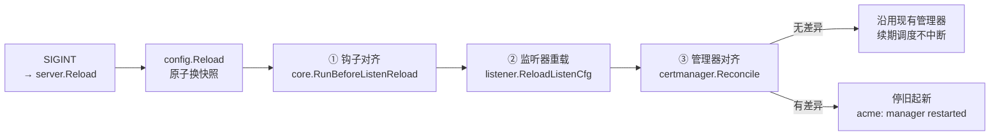

# 4. 配置热重载

状态：✅ 已实现

## 功能

`SIGINT`（或 `reload` 命令）在不停止服务的前提下加载新配置：配置、MIME 表、路由表、日志文件、证书全部原子切换；校验失败保留整份旧状态。

## 使用

```
fast-https reload        # 或向进程发 SIGINT
```

## 实现方案（runtime/server/server.go Reload、runtime/listener/reload.go、config）

### 快照原子切换（架构收敛计划阶段 4b，2026-10 完成）

| 状态 | 策略 |
| --- | --- |
| 配置/MIME | `config.Current()`/`MIME()`（atomic.Pointer），校验全过后整体 Store |
| Listener 路由表 | `Listener.cur atomic.Pointer`，请求路径经 `Hosts()`/`Cfgs()` 读取 |
| 访问日志字段表 | `dynlog.logFields` atomic 整体替换 |
| 四路文件日志器 | `logging.Open` 经 `System()/Access()/Error()/Safe()` 原子换入 |

在途请求与 reload 协程之间没有无同步的共享可变状态；读取端要么看到完整旧状态、要么完整新状态。

### 监听器增删改（listener/reload.go）

- **新增端口**：新建 `*Listener`（新 Lfd/Ctx）→ 发布快照 → `RunAdded` 启动 serveListener。
- **移除端口**：取消 ctx + 关闭 Lfd，serveListener 以 `ErrClosed` 干净退出。
- **common 端口（类型不变）**：直接复用旧 `*Listener` 指针，`updateCfg` 整体替换配置快照——在途 keep-alive 连接即刻读到新路由。
- **类型变化**（http→ssl）：旧监听器关闭、新监听器按新增启动（2026-10 修复：此前新监听器从未被启动、端口死掉）。

### 失败语义

`config.Reload` 校验失败 → 记日志、**保留旧配置与旧监听器**；mime/include 文件出错不 Fatal（2026-10 修复）。

### 配套行为

- reload 成功后按新 `log_root` 重新打开四路日志（新目录打不开则继续写旧文件）。
- `safe.Init`/`dynlog.LogRegister`/`cache.LoadCache` 在每次监听器创建后重跑。

## reload 与后台任务（ACME 证书申请/续期）

reload 是**进程内**热重载：`reload` 命令只给服务进程发 `SIGINT`，进程不退出，pid 与监听 socket 都不变。配置、MIME、路由、日志、证书 PEM 全部原子切换。

证书申请与续期（`modules/certmanager`，certmagic + 两个 solver）同样纳入 reload，改 `acme` 段不再需要 `stop` + `start`：



顺序不能换：

1. **钩子先就位**（`BeforeListenReload`）：`listenSsl` 构造 `tls.Config` 时读 `listener.TLSALPNEnabled()`。provider 晚一步注册，新建的监听器就不会通告 `acme-tls/1`，tls-alpn-01 必然失败。
2. **再重载监听器**：`acme-tls/1` 通告位翻转时（ACME 从关到开、或挑战方式增删 tls-alpn-01），该 ssl 端口必须换一个 `tls.Config`——`NextProtos` 建好就改不了。它走与「监听类型变化」相同的重建路径（`Listener.needsRebuild`）。
3. **最后对齐管理器**：`certmanager.Reconcile` 与启动时走同一段代码，只在有差异时重建。

触发重建的差异（`acmeDiff` + 域名集合比较）：

| 配置项 | 触发重建 | 原因 |
| --- | --- | --- |
| `enabled` | 是 | 开关本身要起停管理器 |
| `email` / `staging` / `cas` | 是 | issuer 与账户注册在构造期定型 |
| `storage` | 是 | `certmagic.FileStorage` 路径在构造期固定 |
| `challenge` | 是 | 决定注册哪些 `acmez.Solver`；`auto` 与显式两种挑战等价，写法顺序无所谓 |
| `renew_before_days` | 是 | 只映射到 `certmagic.Config.RenewalWindowRatio` |
| `Plan.Managed` 域名集合 | 是 | `ManageAsync` 的入参；server 块的排列顺序变化不算 |
| `fallback_self_signed` | 否 | 只在 CLI 摘要与校验里用，运行期不读 |
| `ssl_certificate` 路径 | 否 | `certPaths()` 每次读当前快照 |

失败语义：新配置构造不出管理器（例如挑战方式全写错）时**保留旧管理器继续续期**，只记一条 `acme: kept previous manager, new config is unusable`。

## 测试

`config/reload_window_test.go`（-race 并发读 + 50 次 reload 零撕裂）、`tests/unit_test/runtime/listener/reload_common_test.go`、`runtime/listener/hot_update_race_test.go`、`runtime/server/reload_cert_test.go`、`runtime/server/reload_order_test.go`（钩子先于监听器重载）、`modules/certmanager/manager_reconcile_test.go`（差异判定与停旧起新）、E2E：`FASTHTTPS_E2E_RELOAD=1`。

## 已知限制

- reload 期间新建连接与新配置之间有毫秒级窗口（先切配置后切监听）。
- ACME 管理器重建时，旧实例已停、新实例的 `Present` 还没跑，token 表会空几毫秒；此刻恰好来验证会失败一次，certmagic 自带退避重试。只在该重建时才发生，配置没变的 reload 不受影响。重建 `acme-tls/1` 通告位的那一次还需要换 socket（先关后绑），端口有微秒级不可用窗口。
