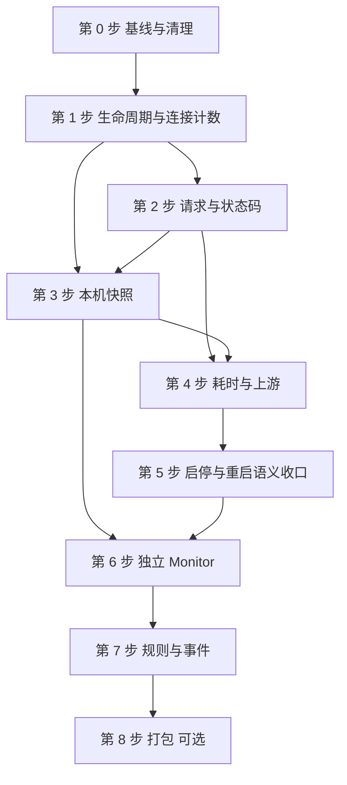

# fast-https Monitor 改造开发计划

日期：2026-11-08。依据 [Monitor 代码扫描报告](fast-https-Monitor代码扫描报告.md) 的结论，把 [开发前置条件与代码扫描清单](fast-https-Monitor开发前置条件与代码扫描清单.md) 落到可逐步执行的方案。CLI 一侧对 `/runtime` 的使用见 [CLI 改造开发计划](fast-https-CLI改造开发计划.md) 的 S11，衔接约定在本文第 3 节。

**执行状态（2026-11-08）：** 第 0–8 步的代码已落地。现行行为看 [20-runtime.md](20-runtime.md) 与 [21-monitor.md](21-monitor.md)。`monitor/` 是独立进程源码，不是旧托盘残留。隔离环境核对与发行版容器实装仍见 [cli-monitor-followup.md](../develop/plans/cli-monitor-followup.md)。下文逐步说明保留开工时的设计。

## 0. 怎么读这份文档

- 第 1 节是给你看的「改造代价」：每一步改了现有代码的哪里、风险多大、做完能得到什么。
- 第 2 节是通用约定与每步都要跑的收口清单。
- 第 2 节之后是逐步计划。每步固定包含：目标、改动范围、实现要点、不做什么、验收测试（自动 + 手工）、回退方式。执行者（人或 AI）按步骤号顺序做，一步一提交。
- 第 3 节起是与 CLI 的衔接、隔离环境核对、不做的事、风险登记和工作约定。

排序规则：按依赖从少到多排，同时也是对数据面影响从小到大：第 1 步只在连接入口出口各加一次原子加减，第 2 步进入每个请求的路径，第 3 步新增监听，第 4 步再加耗时与上游。工作量不写具体时间，用档位表示：S 小、M 中、L 大。

## 1. 改造代价总览

### 1.1 三个里程碑

| 里程碑 | 包含步骤 | 能力 | 对线上服务的影响 |
| --- | --- | --- | --- |
| **A Server 可观测** | 第 0–5 步 | `/runtime` 提供生命周期、连接、请求、状态码、耗时、上游计数、reload 结果与监听端口 | **改 Server 核心**：连接入口、每个请求的路径、启动顺序、reload 与停机路径 |
| **B Monitor MVP** | 第 6–7 步 | 独立 Monitor 进程：周期采集、事件文件、不可达/恢复/重启/5xx 升高，可选的业务端口探测与疑似卡死提示 | 数据面零改动；Monitor 不进请求路径，不被 Server import |
| C 打包（可选） | 第 8 步 | Monitor 进 deb/rpm/apk 与 systemd 单元 | 触碰打包硬规则，需要容器安装验证 |

### 1.2 逐步代价表

文件数是「约」，用于感知量级，不是承诺。

| 步骤 | 交付 | 改现有文件（约） | 新增文件（约） | 触碰的核心模块 | 数据面影响 | 风险 | 档 |
| --- | --- | --- | --- | --- | --- | --- | --- |
| 第 0 步 | 基线、决策、清理残留 | 2（两处 `println`）+ 删 1 个残留文件 | 0 | `modules/safe`（仅删调试输出） | 无 | 低 | S |
| 第 1 步 | 生命周期状态、连接计数、reload 生成号与结果、监听端口副本 | 1–2：`runtime/server/server.go` 及测试 | 约 4：`runtime/metrics` | `runtime/server` | **有**：`serveConn` 入口与出口各一次原子加减 | 中 | M |
| 第 2 步 | 请求数、状态码、解析失败、中途断开、被拒绝连接 | 约 3：`runtime/events/events.go`、`events_h2.go` 及测试 | 约 2 | `runtime/events` | **有**：每请求一次 `defer`、几次原子加减、一次状态行解析 | **高**：热路径，漏路径会让计数不准 | M–L |
| 第 3 步 | 本机只读 `/runtime` | 2：`cmd/commands.go`、`cmd/handlers.go` | 约 3 | `cmd`（组合根）、`runtime/metrics` | 无热路径影响；新增一个监听端口 | 中：启动顺序、绑定失败隔离 | M |
| 第 4 步 | 耗时直方图、上游计数 | 约 4：`runtime/events/events.go`、`modules/proxy/event_proxy.go`、`proxy_read.go`、`pool.go` | 约 3 | `runtime/events`、`modules/proxy` | **有**：每请求一次 `time.Since` 与桶累加；上游错误路径加一 | 中 | M |
| 第 5 步 | 启停与重启语义收口、E2E | 约 2（测试） | 约 2 | 无 | 无 | 低 | S–M |
| 第 6 步 | 独立 Monitor：采集、事件文件、重启识别 | 0（删除一个残留文件） | 约 8：`monitor/` | 无 | 无 | 低–中 | M |
| 第 7 步 | 规则：不可达/恢复、5xx 升高，可选的业务端口探测与疑似卡死 | 0 | 约 4 | 无 | 无 | 低 | S–M |
| 第 8 步 | Monitor 打包与 systemd 单元（可选） | 约 6：`build/goreleaser.yaml`、`build/spec`、`build/packaging/*`、`tests/packaging` | 约 3 | 无（但触碰打包硬规则） | 无 | 中 | M–L |

### 1.3 用大白话说代价

- **里程碑 A 是真正动 Server 核心的部分。** 改动本身不大（几处原子加减和一个小监听），但落在连接入口、每个请求的路径和启动顺序上，出错的后果是计数不准甚至影响请求。所以每一步都要有 `-race`、压测对比和现有 E2E 兜底。
- **最需要小心的是第 2 步。** 它进入每个请求的路径，要覆盖 HTTP/1.1 与 HTTP/2，要正确处理几种静默断开，还要避开「`Response` 随连接复用导致状态码串号」。这一步的测试用例比代码还多。
- **里程碑 B 几乎零风险。** Monitor 是独立进程，读 `/runtime`，写自己的事件文件，崩了也不影响 Server。
- **不做会怎样：** 只做到里程碑 A，已经能用 `curl` 或 CLI 看到真实运行状态，也能支撑 CLI 的 reload 强验证，但没有持续监控；做到里程碑 B 才有「从运行变成不可达」「5xx 升高」这类被动发现能力。

### 1.4 依赖关系



第 3 步可以在第 2 步完成前先做出只含第 1 步字段的版本，但计划按顺序合并，避免接口反复改。

### 1.5 清单要求的指标由哪一步交付

对应清单第 5 节「第一阶段最小 Runtime 指标」。

| 类别 | 指标 | 步骤 |
| --- | --- | --- |
| Server | state / uptime / version / start time | 第 1、3 步 |
| Connection | active connections；accepted / closed total | 第 1 步 |
| Request | active requests、requests total | 第 2 步 |
| HTTP | 2xx/3xx/4xx/5xx total | 第 2 步 |
| Request | request duration | 第 4 步 |
| Resource | memory / open files / CPU | Monitor 读操作系统（第 7 步可选） |
| Upstream | failures / idle | 第 4 步（健康检查不做） |
| Monitor | last collection time | 第 6 步 |

## 2. 通用约定与收口清单

### 2.1 环境准备（Windows PowerShell）

本机默认 `GOROOT` 与 `go.mod` 的工具链不一致，必须先固定，否则所有包都编译失败：

```powershell
cd e:\Open_source_project\fast-https\fast-https-src
$tc = Join-Path (go env GOMODCACHE) "golang.org\toolchain@v0.0.1-go1.27.1.windows-amd64"
$env:GOROOT = $tc; $env:GOTOOLCHAIN = "local"; $env:PATH = "$tc\bin;$env:PATH"
go version   # 应为 go1.27.1
```

手工验收需要一个运行中的实例。先编译，再在临时目录里复制 `config/` 与 `httpdoc/` 起实例（参照 `tests/scripts/dev-test.ps1`），不要在仓库根目录直接起，以免改动仓库里的 `config/fast-https.json` 与日志：

```powershell
$fh = Join-Path $env:TEMP "fh-mon\fast-https.exe"
go build -o $fh .
```

### 2.2 每一步的收口清单（CHK）

每步合并前必须全部通过，各步的「验收」只列该步额外的内容：

1. `go build ./... && go vet ./...`，以及 `go vet -tags=rpm ./...`。
2. `go test -p 1 -count=1 ./runtime/... ./modules/proxy/... ./cmd/... ./tests/arch/...`。
3. `go test -race` 作用于该步触及的包（`./runtime/server/ ./runtime/events/ ./runtime/metrics/ ./modules/proxy/`）。
4. 现有集成测试不退化：`go test -count=1 ./tests/client_test`。
5. 第 2、4 步合并前后各做一次同一静态文件、同一并发数的压测，记录吞吐与延迟的差异写进提交说明；没有现成基准，不设未经测量的门槛。
6. 文档：结构变化同步 `docs/architecture-map.md`（登记 `runtime/metrics` 与 `/runtime` 监听）；行为变化在 `docs/feature/` 下新增一篇 `/runtime` 快照说明（编号接在现有最大编号之后，同步 `docs/feature/README.md`）。
7. 一步一个提交，提交信息写步骤号。

### 2.3 计数规则

贯穿各步：

- Counter 只增。Gauge 是当前值，用 `defer` 减回去，覆盖提前返回和 panic。
- reload 不清任何累计值，也不改 `started_at`。进程重启后内存计数自然从零开始，快照用新的 PID 和 `started_at` 让 Monitor 认出重置。
- 没有测到的字段不要写 `0`。接口还没做出来之前，测试直接读进程内快照函数。
- 数据口径、版本兼容策略以 [扫描报告第 5 节](fast-https-Monitor代码扫描报告.md) 为准：只新增字段不升 `schema_version`；`requests.total` 只含进入 `EventHandler` 的请求；解析失败与被拒绝连接单独计。

### 2.4 分层约束与不可触碰清单

- `runtime` 不能 import `modules`；`modules` 只能依赖 `runtime/{listener,request,response,dynlog}`，不能依赖 `runtime/metrics`（`tests/arch/layering_test.go`）。连接和请求计数放在 `runtime/metrics`；上游计数留在 `modules/proxy`，由 `cmd`（组合根）通过通用注册函数交给快照，不能让 `runtime` 去引用代理包。
- 不可触碰：`modules/safe/control.go` 及其配套（AGENT.md 规则 5）；`infra/logging/consts.go` 的字段名（对外契约）；`desktop/` 下的文件；归档布局的四个路径常量。
- 测试里的全局原子量会串用例：计数相关测试之间要清空，不用 `t.Parallel`。

---

## 第 0 步 基线、决策与清理

**目标：** 固定环境，确认 [扫描报告第 9 节](fast-https-Monitor代码扫描报告.md) 的决策点 MD1–MD6，清掉会干扰后续工作的残留。

**影响：** 极小。

**改动范围：**

| 类型 | 文件 | 内容 |
| --- | --- | --- |
| 修改 | `modules/safe/limit.go`、`modules/safe/control.go` | 删除两处调试用 `println`（决策 MD4；单独提交，不与功能混在一起） |
| 删除 | `monitor/monitor.exe` | 开工前的旧托盘构建残留，未入库（决策 MD5）。落地后的 `monitor/` 是本计划第 6 步的源码，不要再删 |
| 修改 | `config/consts.go` | 删除没有任何引用的 `MONIITOR_LOG_FILE_PATH`（决策 MD5；`go build ./...` 确认无引用） |

**执行：**

1. 按 2.1 节固定工具链，跑一遍基线：`go build ./... && go test -p 1 -count=1 ./runtime/... ./modules/... ./cmd/... ./tests/arch/... ./tools/...`，期望全绿（2026-11-08 已对其中 `cmd`、`config`、`modules/site`、`modules/certmanager`、`runtime/server`、`tests/arch`、`tools` 验证过）。
2. 把 MD1–MD6 逐条确认；没有异议就按推荐值。
3. 开分支，例如 `feature/runtime-snapshot`。

**验收测试（自动）：**

| 测试 | 断言 |
| --- | --- |
| `go test ./modules/safe/...` | 删除 `println` 后全部通过，行为不变 |
| `go test ./config/...` 与两种 tag 的 `go vet` | 删除常量后无编译错误 |

**验收（手工）：** 限流场景下（对同一实例用多个来源地址访问）确认 `daemon.log` 或标准错误里不再出现 `ALLOW-CREATE`、`APPLYRATE enter`。

**回退：** revert 对应提交。

---

## 第 1 步 生命周期状态与连接计数

**目标：** 在进程内建立一份可原子读取的运行状态：生命周期、连接计数、reload 结果、监听端口副本。只加进程内数据，不加端口，不改 JSON 配置。

**影响：** 中。数据面上只有 `serveConn` 入口与出口各一次原子加减；生命周期写入发生在启动、reload、停机这些低频路径。

**改动范围：**

| 类型 | 文件 | 内容 |
| --- | --- | --- |
| 新增 | `runtime/metrics/state.go` | 状态（`starting`、`running`、`reloading`、`stopping`）、`started_at`、PID、版本、`config_generation`、`last_reload_ok`、`last_reload_at`、`reload_failed_total`、`stop_timeout_total` |
| 新增 | `runtime/metrics/counters.go` | 连接计数：`accepted_total`、`closed_total`、`active` |
| 新增 | `runtime/metrics/listeners.go` | 监听端口列表：整体替换的只读副本（原子指针） |
| 新增 | `runtime/metrics/*_test.go` | 单元测试 |
| 修改 | `runtime/server/server.go` | `ServerInit`、`Reload`、`gracefulStop`/`drainConnections`、`serveConn` 里挂接 |
| 修改 | `tests/arch/layering_test.go` | 如需，登记 `runtime/metrics` 属于 `runtime` 层（前缀规则已覆盖则不改） |

**实现要点：**

- 包初始化时状态写成 `starting`。字符串的零值是空串，不能把空串当成 `starting`；用明确的整数枚举，对外再映射成字符串。
- `ServerInit` 记下 `started_at`、`os.Getpid()` 和 `config.CURRENT_VERSION`；监听建立后进入 `running`；同时写入监听端口副本（端口、是否 ssl、是否 h2，取自 `Listener` 现有字段，具体字段名在实现时确认）。
- `Reload` 开头进入 `reloading`，用 `defer` 保证无论成功失败返回前都回到 `running`（失败时旧监听仍在服务）。成功路径末尾：`config_generation` 加一、`last_reload_ok=true`、`last_reload_at` 更新、监听端口副本整体替换；`reloadConfig()` 返回错误：`reload_failed_total` 加一、`last_reload_ok=false`。`logging.Open` 失败（保留旧日志文件）不算 reload 失败。
- 快照不去读 `Server.Listens`：`Reload` 里 `s.Listens = lisAll` 是无锁赋值，并发读会有数据竞争。
- `gracefulStop` 进入 `stopping`；`drainConnections` 走到超时分支时 `stop_timeout_total` 加一。
- 连接只加三个数：在 `serveConn` 确认不是停机丢弃之后加接受数和活动数，在处理协程的 `defer` 里加结束数并减活动数。HTTP/1.1 与 HTTP/2 都走 `serveConn`，所以两种连接都算。停机时尚未进入处理的连接直接关掉，不计入接受数。
- 监听失败仍保持现在的 `Fatal` 退出，这一步不发明「降级」状态。
- 两次 reload 信号紧挨着到达时（`signal.Notify` 通道容量为 1）可能只处理一次，调用方只能依赖「生成号增加了」，不能依赖「恰好加一」。

**不做：** 请求数、状态码、耗时、上游、HTTP 接口；连接读/写/空闲阶段。

**验收测试（自动）：** 测试放在 `runtime/metrics` 与 `runtime/server`。

| 测试 | 断言 |
| --- | --- |
| `TestInitialStateIsStarting` | 初始状态是 `starting`；监听建立后（用测试替身调用）变为 `running` |
| `TestReloadFailureKeepsRunning` | 沿用现有「保留旧配置」路径：结束后状态 `running`，`started_at` 不变，已有计数不变，`reload_failed_total` 加一，`config_generation` 不变，`last_reload_ok=false` |
| `TestReloadSuccessBumpsGeneration` | 成功后生成号加一，`last_reload_ok=true`，`last_reload_at` 更新，监听端口副本被替换 |
| `TestConnCounters` | 两个连接先后进入并退出：`accepted_total=2`、`closed_total=2`、`active=0` |
| `TestConnCounterPanic` | 处理函数 panic 时，`defer` 仍把 `active` 减回去 |
| `TestConnCounterNotCountedWhenStopping` | 停机期间被丢弃的连接不计入接受数 |
| `TestConcurrentCounters`（`-race`） | 并发加减，`active` 不为负，无数据竞争 |
| `TestStopTimeoutCounter`（仅 Unix） | 超时分支 `stop_timeout_total` 加一；Windows 上该用例跳过并注明原因 |
| `TestLayering` | 通过 |

**验收（手工）：** 本步没有对外接口，不做手工验收。

**回退：** revert。`runtime/metrics` 是新增包，`runtime/server` 的改动只是几处调用。

---

## 第 2 步 请求数、状态码、解析失败与中途断开

**目标：** 每条请求（含同一连接上的多次 keep-alive 请求）逐条计数，并按最终状态码分类；把几种失败路径各自归类。仍然只在进程内。

**影响：** 中到大，进入每个请求的路径。

**改动范围：**

| 类型 | 文件 | 内容 |
| --- | --- | --- |
| 新增 | `runtime/metrics/requests.go` | 请求与状态码计数、`parseStatus(firstLine) (code int, ok bool)` |
| 修改 | `runtime/events/events.go` | `EventHandler` 入口 `defer`；`parseRequest` 各出口加计数；`HandleEvent` 的 `ConnFilter` 拒绝处加计数 |
| 修改 | `runtime/events/events_h2.go` | `H2HandleEvent` 的 `ConnFilter` 拒绝处、`ServeHTTP` 里 `fillRequest` 失败处加计数 |
| 修改 | `runtime/events/*_test.go` | 直接调 `EventHandler` 的现有测试在用例前后清空计数 |

**实现要点：**

- 活动请求、累计请求和状态码的计数放在 `EventHandler` 入口的 `defer` 里，不放在 `HandleEvent` 里。`HandleEvent`（HTTP/1.1）和 `h2Handler.ServeHTTP`（HTTP/2）都调它，一处计数覆盖两种协议，也覆盖它内部的各个提前返回（ACME 挑战、421、404、拒绝钩子等）。
- `parseRequest` 的返回值契约保持不变（现有 `chunked_framing_test.go`、`fragment_test.go` 断言 1 和 0），不要为了计数改成多个返回码，在各出口处直接加计数。`return 0` 的原因分四类：
  - 首次读到 EOF 或读超时：客户端关闭，只算连接结束，不计数；
  - 头部畸形或超长，已写出 400：计入 `parse_errors_total`；
  - 头部没收完时读失败、请求体读失败或超时、请求体超过 `MaxBodySize`、分块解码失败：没有写响应就断开，计入 `aborted_total`，不计入 `parse_errors_total`，也不计入 `requests_total`；
  - `HttpParseFilter` 目前恒返回 true，`-300` 分支不可达，不处理。
- 状态码在 `defer` 里读取。`response.Response` 没有单独的状态码字段，`SetFirstLine` 只把码写进 `FirstLine` 字符串。另写返回（状态码, 是否解析成功）的 `parseStatus`；解析不出时计入 `responses_unknown_total`，不要算进 2xx，也不要复用解析失败会回落 200 的 `statusFromFirstLine`。若在 `SetFirstLine` 里另存一个整数，也必须以 `FirstLine` 为准，避免两个来源不一致。
- HTTP/1.1 的 `Response` 随连接复用，`parseRequest` 只对请求做 `Flush`，`static`（`rr.Res.SetFirstLine`）、`dev_mod`、`rewrite` 就地改写同一个对象；某条路径若没有设置状态行，`defer` 读到的就是上一个请求的残留。做法：请求进入 `EventHandler` 时先清空 `Res.FirstLine`（一次字符串赋值），读不到就计入 `responses_unknown_total`。HTTP/2 每个流都新建 `Event` 和 `Response`，没有这个问题。
- HTTP/2：`h2Handler.ServeHTTP` 里 `fillRequest` 返回 false 时已经写了 400 且没有进入 `EventHandler`，这条计入 `parse_errors_total`，不计入 `requests_total`。其它还分不清的 H2 流错误先不要猜，记在实现说明里留到后面。
- 被 `ConnFilter` 拒绝的连接：在 `HandleEvent` 与 `H2HandleEvent` 的 `ConnFilter` 返回 false 处各加一次 `connections.rejected_total`。这些连接已经计入 `accepted_total` 和 `closed_total`，不会进入请求计数。
- `modules/safe` 的 `totalChecked` 仍是每条连接的限流检查次数，测试里断言它和 `requests_total` 不是同一个数。

**不做：** 耗时（第 4 步）；连接读/写/空闲阶段；对 H2 流级错误的细分。

**验收测试（自动）：**

| 测试 | 断言 |
| --- | --- |
| `TestKeepAliveTwoRequests` | 同一连接上两轮请求：`requests_total=2`，结束后 `requests.active=0`，`connections.active` 仍按连接算 |
| `TestStatusBuckets` | 静态 200、未命中 location 的 404、处理函数的 500，分别只增加对应分桶 |
| `TestMalformedHeaderIs400` | 畸形请求头走 400：`parse_errors_total` 加一，`requests_total` 不变 |
| `TestClientAbortMidRequest` | 读到一半客户端断开：活动连接回到 0，`parse_errors_total` 不增加 |
| `TestKeepAliveNoStaleStatus` | 同一条连接上依次请求 200、404、200：`2xx=2`、`4xx=1`，不出现上一个请求的残留状态 |
| `TestBodyTimeoutAndTooLarge` | 请求头发完、请求体读超时或超过 `MaxBodySize`：`aborted_total` 加一，`parse_errors_total` 与 `requests_total` 不变 |
| `TestChunkedDecodeFailure` | 分块解码失败：计入 `aborted_total` |
| `TestConnFilterRejected` | 命中黑名单或限流：`rejected_total` 加一，`requests_total` 不变，且与 `modules/safe` 的拒绝计数各自独立 |
| `TestWebSocketUpgrade` | 升级请求计一次，之后的帧不再增加 `requests_total`，`connections.active` 在会话期间保持为 1 |
| `TestHTTP2ConcurrentStreams` | 一条连接并发多个流：`requests.active` 可以大于 `connections.active`，结束后都回到 0 |
| `TestH2FillRequestFailure` | `fillRequest` 失败：`parse_errors_total` 加一，不进 `requests_total` |
| `TestParseStatus` | 合法状态行解析正确；空串、乱码返回 `ok=false` 且计入 unknown |
| `TestPanicInHandler` | 处理函数 panic：`requests.active` 回到 0 |
| 现有 `runtime/events` 全部测试 | 通过 |
| 压测对比 | 记录前后吞吐与延迟差异（CHK 第 5 条） |

**验收（手工）：** 本步没有对外接口，不写 E2E。

**回退：** revert。计数点集中在 `EventHandler` 与几个出口处，不改变任何业务返回。

---

## 第 3 步 本机只读快照 `/runtime`

**目标：** 提供独立 Monitor 与 CLI 读取状态的唯一出口，也是第一次增加监听。

**影响：** 中。无热路径影响，但新增监听端口并改变启动顺序。

**改动范围：**

| 类型 | 文件 | 内容 |
| --- | --- | --- |
| 新增 | `runtime/metrics/snapshot.go` | `Snapshot()`：组装 `schema_version "1"` 的可序列化结构，只 `Load` 原子值；提供通用的「分段注册」函数，供 `modules/proxy` 之类经组合根挂入 |
| 新增 | `cmd/runtime_endpoint.go` | 只绑 `127.0.0.1:9088` 的 HTTP 服务，路径 `/runtime`；绑定失败只打错误日志 |
| 修改 | `cmd/commands.go` | `StartHandler` 在写完 PID 之后、`InitSystem` 之前启动这个监听 |
| 修改 | `cmd/handlers.go` | `RegisterServices` 里把监听的关闭挂到 `AfterStop` |
| 新增 | `cmd/runtime_endpoint_test.go` | 测试用 `:0`，不占用固定端口 |

**实现要点：**

- **启动时机（决策 MD1）：** 在 `StartHandler` 写完 PID 之后、`InitSystem` 之前启动监听，而不是等 `ServerInit` 之后。启动期要做证书初始化（首次要生成 RSA 3072 的 CA，`daemonStartTimeout` 的注释也提到这一点），这段时间 `/runtime` 返回 `state:"starting"`，Monitor 才能区分「正在启动」和「已经挂了」。Unix 后台模式下父进程在 `daemonize` 后就返回了，监听只会在真正提供服务的子进程里起。
- **关闭：** 在 `core.Services.AfterStop` 里关闭监听，不阻塞停机。Windows 的 `Kill` 路径没有这一步，由系统回收。
- **绑定失败**只打错误日志，`StartHandler` 照常进入业务服务，业务端口不受影响。
- `GET /runtime` 返回 JSON，`Content-Type: application/json`。字段只含本步已有的量（第 1、2 步），加上 `schema_version`、`observed_at`、`server.*`、`listeners`；耗时和上游还没有时，省略这两个对象，不要填 0。
- 只绑 IPv4 回环；其它路径返回 404，不带业务站点内容；读取过程只调用原子 `Load`，不拿 `Server.mu`，不遍历连接。
- 响应里不得出现黑名单、证书路径、Cookie、`Authorization`、请求 URI、上游地址。
- 容器场景：回环只在同一个网络命名空间内可达；第一阶段要求 Monitor 与 Server 同机同命名空间，写进文档。

**不做：** CLI 子命令（CLI 的 `runtime status` 以后只读这个接口，不另写一套计数）；认证与 TLS（回环、无敏感内容）；端口配置项（决策 MD2）。

**验收测试（自动）：**

| 测试 | 断言 |
| --- | --- |
| `TestRuntimeEndpointFields` | 字段与进程内计数一致，`schema_version` 为 `"1"`，`observed_at` 存在 |
| `TestRuntimeEndpointBindFailure` | 绑定一个已被占用的地址时函数返回错误，调用方可以继续跑业务监听（用现有的小监听测试代替真正的 `start`） |
| `TestRuntimeEndpoint404` | 非 `/runtime` 得到 404 |
| `TestRuntimeStartingState` | `InitSystem` 期间（用一个会阻塞的假初始化）请求 `/runtime`：`state` 为 `starting`；`ServerInit` 完成后变为 `running` |
| `TestRuntimeClosedAfterStop` | `AfterStop` 之后监听已关闭，再请求得到连接失败 |
| `TestRuntimeNoSensitiveWords` | 响应体用固定禁止词扫描，没有 `blacklist`、`ssl_certificate`、`cookie`、`authorization` |
| `TestRuntimeLoopbackOnly` | 监听地址是 `127.0.0.1`，不是 `0.0.0.0` |
| `TestSectionRegistration` | 经通用注册函数挂入的分段出现在快照里，注册为空时省略该分段 |
| `go test -count=1 ./tests/client_test` | 现有的代理与 HTTP/2 集成测试仍然通过 |

**验收（手工）：**

```powershell
# 在临时目录起一个实例后
Invoke-RestMethod http://127.0.0.1:9088/runtime | ConvertTo-Json -Depth 5
# 业务端口正常服务；再占住 9088 后重启实例，业务端口仍可访问
```

**回退：** revert。监听是新增的，`StartHandler` 与 `RegisterServices` 的改动各是几行。

---

## 第 4 步 耗时直方图与上游计数

**目标：** 补上请求耗时分布和上游失败计数。

**影响：** 中。每请求多一次 `time.Since` 和桶累加；上游错误路径上加原子加一。

**改动范围：**

| 类型 | 文件 | 内容 |
| --- | --- | --- |
| 新增 | `runtime/metrics/histogram.go` | 固定桶直方图 |
| 修改 | `runtime/events/events.go` | 第 2 步那个 `defer` 里记录耗时 |
| 新增 | `modules/proxy/metrics.go` | 上游计数与对外读取函数（不 import `runtime/metrics`） |
| 修改 | `modules/proxy/event_proxy.go`、`proxy_read.go` | 在错误产生处计数 |
| 修改 | `modules/proxy/pool.go` | 空闲数原子计数 |
| 修改 | `cmd/handlers.go` | `RegisterServices` 里把上游计数注册为 `/runtime` 的 `upstream` 分段 |

**实现要点：**

- **耗时：** 在第 2 步那个 `defer` 里用开始时的 `time.Now()` 做 `time.Since`（单调时钟，不受对时影响）。桶边界固定为 1ms、5ms、10ms、25ms、50ms、100ms、250ms、500ms、1s、5s，另加 `+Inf`。上报各桶累计个数和总次数，单位毫秒。口径是「进入 `EventHandler` 到返回」，不含读请求头和排队；HTTP/2 在 `EventHandler` 返回后才写响应的那部分不在内。不引入 Prometheus 客户端。
- **上游计数加在错误产生的那一处，不加在 `==` 比较处。** 这几个错误值在 `proxyNoCache`、`getDataFromServer`、`readFromUpstreamServer` 等多处被比较，每处都加会重复计数：
  - 拨号失败：只在 `dialUpstream` 里 `net.Dial` 失败的分支加。`ProxyErrorDialUpstream` 还在 websocket 的 `CircleData` 类型转换失败处返回，那不是拨号失败，不计入。`getDataFromServer` 里复用连接失效后换新连接重试也会走 `dialUpstream`，这次拨号失败是真实失败，正常计入；重试成功则三个失败计数都不加。
  - 发送超时：只在 `sendToUpstreamServer` 把写错误转换成 `ProxyErrorSendToUpstreamTimeout` 处加。
  - 读超时：只在 `proxy_read.go` 里产生 `ProxyErrorReadFromUpstreamTimeout` 的两处加。
- **连接池空闲数**用一个原子计数，在 `get`、`put`、清扫协程里随空闲列表一起增减，读取时直接 `Load`，不拿池锁，也不输出按上游地址分组的明细（地址是内部拓扑）。
- 上游计数放在 `modules/proxy`，由 `cmd` 在组装时注册进 `/runtime` 的 `upstream` 对象。没有代理流量时计数是 0，这是真实的零，不是未知。
- `/runtime` 从这一步起带上 `request_duration` 和 `upstream`。旧字段的名字和含义不变。

**不做：** 分位数计算；上游健康检查；按上游地址分组。

**验收测试（自动）：**

| 测试 | 断言 |
| --- | --- |
| `TestDurationFastRequest` | 立即返回的请求落在最小桶 |
| `TestDurationSlowRequest` | 测试里让处理函数睡过 30ms，只增加 25ms 及以上的桶 |
| `TestDialFailCounted` | 拨号到没有人监听的地址：`dial_fail_total` 加一，业务仍返回现有的上游失败响应 |
| `TestReusedConnRetrySucceeds` | 复用的空闲连接已被上游关闭、换新连接重试成功：三个失败计数都不增加 |
| `TestReusedConnRetryDialFails` | 重试时新拨号失败：`dial_fail_total` 只加一 |
| `TestReadTimeoutCountedOnce` | 同一次读超时在多处被比较，`read_timeout_total` 只加一，也不会再记进拨号失败（复用现有上游读超时测试） |
| `TestWebsocketConvertNotDial` | websocket 的 `CircleData` 类型转换失败不增加 `dial_fail_total` |
| `TestPoolIdleCounter`（`-race`） | 放回、借出、清扫之后，空闲计数与池里实际条数一致 |
| `TestCountersSurviveReload` | reload 之后累计值不变 |
| `TestUpstreamSectionOmittedWithoutProxy` | 没有注册分段时 `/runtime` 不含 `upstream` |
| 压测对比 | 记录前后吞吐与延迟差异（CHK 第 5 条） |

**验收（手工）：**

```powershell
# 配一个代理站点指向一个已停止的上游，请求几次，再看 /runtime 的 upstream.dial_fail_total
Invoke-RestMethod http://127.0.0.1:9088/runtime | Select-Object -ExpandProperty upstream
```

**回退：** revert；计数与注册是各自独立的小改动。

---

## 第 5 步 启停与重启语义收口

**目标：** 不增加新指标种类，把前面几步在真实启停路径上对死，避免 Monitor 以后把 reload 看成重启。

**影响：** 无新增生产代码，只补测试和做一次隔离环境核对。

**改动范围：** 补 `runtime/server`、`tests/client_test` 的测试；必要时修正前几步遗漏的出口。

**验收测试（自动）：**

| 测试 | 断言 |
| --- | --- |
| `TestReloadSuccessState` | 状态经历 `reloading` 后回到 `running`；`started_at` 与各项 Counter 不变；Gauge 仍反映当前连接；`config_generation` 加一、`last_reload_ok` 为真、`last_reload_at` 更新 |
| `TestReloadFailureState` | 状态回到 `running`；`reload_failed_total` 加一；`config_generation` 不变；`last_reload_ok` 为假 |
| `TestListenersAfterReload` | 新增或移除端口的 reload 之后，`listeners` 与实际监听一致 |
| `TestStopTimeoutCounter`（仅 Unix） | 用一个不返回的处理函数和很短的超时，`stop_timeout_total` 加一，不要真的等 5 秒 |
| E2E：进程重启（`tests/client_test`，用环境变量开关，默认跳过） | 起两个短生命周期子进程：第二个进程的 `/runtime` 是新 PID、新的 `started_at`，`requests_total` 从 0 开始。测试结束清掉子进程和临时配置，不改仓库里的 `config/fast-https.json` |
| E2E：Windows | `stop` 后 `/runtime` 连接失败，PID 文件被清理；`stopping` 状态与 `SIGTERM` 相关用例只在 Unix 跑，Windows 上不断言 |

reload 新增被占用端口会直接 `Fatal`（进程退出），这条路径无法在进程内断言，只在第 4 节的隔离环境核对里确认「进程退出、重启后 `started_at` 与 PID 变化」。

**验收（手工）：** 见第 4 节。Windows 上 E2E 若因进程权限失败，记下具体错误，不要改成跳过还宣称通过。

**回退：** 测试 revert；若修正了前几步的出口，随该步回退。

**里程碑 A 验收（第 0–5 步完成后）：** `go test -p 1 ./...` 与 `-race` 相关包全绿；`go test ./tests/arch/` 通过；现有代理与 HTTP/2 集成测试通过；第 2、4 步的压测对比已记录；CLI 的 S11 可以开工（它只读 `/runtime`）。

---

## 第 6 步 独立 Monitor 进程

**目标：** 新建独立常驻进程，周期读取 `/runtime`，记录原始快照和事件，识别「不可达」与「进程已重启」。

**影响：** 数据面零改动。Monitor 不进 Server 的请求路径，也不被 `fast-https` 的 `start` import。

**改动范围：**

| 类型 | 文件 | 内容 |
| --- | --- | --- |
| 新增 | `monitor/`（建议独立 `go.mod`，或放同一 module 的独立 `main` 包） | `main.go`、`config.go`（Monitor 自己的配置）、`collector.go`（周期采集）、`events.go`（事件文件与自带轮转）、`clock.go`（可替换时钟）、测试 |
| 删除 | `monitor/monitor.exe` | 若第 0 步未删 |
| 新增 | `docs/feature/` 下的 Monitor 说明 | 部署方式、配置项、事件文件格式、已知限制 |

**实现要点：**

- 第一版只做三件事：按配置的周期 `GET 127.0.0.1:9088/runtime`；把原始快照追加到本地 JSON 行文件；在连续失败时写一条「不可达」事件。默认周期 5 秒、超时 1 秒。
- 失败要区分：连不上、HTTP 非 200、JSON 不合 schema、`schema_version` 不认识。
- PID 或 `started_at` 变化时写一条「进程已重启」，计数变小不算负流量。
- 判断「进程死了」时，除了 `/runtime` 连不上，还读 PID 文件（路径来自 Monitor 配置，或 `fast-https config path --json`）确认进程是否存在，区分「启动中」「已崩溃」「从未启动」。
- Monitor 自己的配置单独一个文件：采样周期、快照地址、事件文件路径、PID 文件路径。不写入站点 `fast-https.json`。
- 事件文件由 Monitor 自己限制大小与轮转（例如单文件 10MB、保留 3 个）；默认放在日志目录下的独立子目录。若后续进安装包（第 8 步），要纳入 logrotate 覆盖或保持自轮转，并过 `tests/packaging`。
- 部署：第一阶段只写 Linux systemd 单元草案（`Restart=on-failure`，不 `Requires=` Server，Server 也不 `Requires=` Monitor）；Windows 与容器下 Monitor 作为普通进程由使用者自行托管。
- Monitor 没启动时，第 3 步的测试仍然能直接访问 `/runtime`。

**不做：** 规则与告警（第 7 步）；读操作系统资源（第 7 步可选）；任何写入 Server 的动作。

**验收测试（自动）：** 用 `httptest` 模拟快照服务，时钟换成测试替身，不在单元测试里真的循环 5 秒。

| 测试 | 断言 |
| --- | --- |
| `TestCollectOK` | 正常一条：原始快照被追加，字段完整 |
| `TestCollectUnreachable` | 连不上：连续 3 次后写「不可达」，且只写一次 |
| `TestCollectBadStatusAndJSON` | HTTP 非 200、JSON 不合 schema、`schema_version` 不认识：各自区分类别，不 panic |
| `TestRestartDetected` | PID 或 `started_at` 变化：写「进程已重启」，计数下降不产生负增量 |
| `TestPidFileDisambiguation` | `/runtime` 不可达且 PID 文件进程不存在：判为已崩溃；PID 文件不存在：判为从未启动 |
| `TestEventFileRotation` | 超过大小上限后轮转，保留份数正确 |
| `TestConfigSeparate` | Monitor 配置不读取站点 JSON |
| `go test ./runtime/...` | 不因 Monitor 的依赖变红 |

**验收（手工）：**

1. 起 Server 与 Monitor，确认事件文件里有快照。
2. 停掉 Server：Monitor 写「不可达」；重新起 Server：写「进程已重启」。
3. 停掉 Monitor，再请求业务端口，响应与 `/runtime` 都不受影响。

**回退：** 直接删除 `monitor/` 目录与说明文档；Server 不受影响。

---

## 第 7 步 规则与事件

**目标：** 加两条确定性规则（不用模型），并写本地事件文件；可选再加两条提示类规则。

**影响：** 无。

**改动范围：** `monitor/` 内新增 `rules.go`、`rules_test.go`，扩展 `events.go`。

**实现要点：**

- **必做两条：**
  - 连续 3 次采集失败写「不可达」，之后有一次成功写「恢复」；
  - 最近 1 分钟的 5xx 增量除以请求增量，超过配置阈值且请求增量至少 20，写「5xx 升高」。请求增量不足 20 时不告警，避免除以很小的数。
- **可选两条**（决策 MD3）：
  - 业务端口不可达：用快照里的 `listeners` 对业务端口做 TCP 连接探测，`/runtime` 正常但业务端口连不上时写事件；
  - 疑似卡死：`requests.active` 长时间不降且 `requests.total` 不再增长，只提示、不下结论。
  这两条是清单里「外部探测」的最小实现，不引入新依赖。
- 同一条规则在触发后的冷却时间内不重复写，冷却默认 5 分钟。事件含时间、规则名、严重级别和触发时的快照摘要。不发邮件，不调 Webhook。
- reload 新增被占用端口导致进程退出时，Monitor 看到的是 `started_at` 与 PID 变化，按「进程已重启」记录即可。
- 内存、文件描述符和 CPU 不在 Server 里做。这一步若要做，只在 Monitor 里对快照中的 PID 读操作系统（Linux 的 `/proc`）；读不到就在事件里写未知，不要当成 0；不做对应的告警规则。

**不做：** 耗时升高、内存增长这类窗口规则；邮件、Webhook、自动重试；自动修复。

**验收测试（自动）：** 用假的计数序列驱动规则。

| 测试 | 断言 |
| --- | --- |
| `TestRuleUnreachableAndRecover` | 连续 3 次失败写不可达，之后一次成功写恢复 |
| `TestRule5xxRatio` | 超过阈值且请求增量不少于 20：触发；请求增量不足 20：不告警 |
| `TestRuleCooldown` | 冷却期内不重复写，冷却结束后可再次触发 |
| `TestRuleCounterReset` | 计数因重启下降时不产生负增量，不误报 |
| `TestRulePortProbe`（可选） | `/runtime` 正常但端口连不上：触发；端口正常：不触发 |
| `TestRuleStuckHint`（可选） | 活动请求长时间不降且总数不增：写提示事件；正常波动不触发 |
| `TestEventFields` | 事件含时间、规则名、严重级别、快照摘要，不含敏感内容 |

不需要把规则接到线上进程才能合并这一步。

**验收（手工）：** 对测试实例制造一次 5xx 升高（例如把站点指到失效上游），确认事件文件里出现「5xx 升高」且冷却期内不重复。

**回退：** revert。

**里程碑 B 验收（第 6–7 步完成后）：** Monitor 包测试全绿；`go test ./runtime/...` 不受影响；手工确认不可达、重启、5xx 升高三类事件；停掉 Monitor 对 Server 无影响。

---

## 第 8 步 Monitor 打包与 systemd 单元（可选）

**目标：** 让 Monitor 随安装包发布，并有独立的 systemd 单元。

**影响：** 触碰 AGENT.md 规则 1、2（打包文件行尾、两套目录布局）。放最后，并建议单独评审（决策 MD6）。

**改动范围：** `build/goreleaser.yaml`（构建与 nfpms 段）、`build/spec`、`build/packaging/systemd/` 新增 Monitor 单元、`build/packaging/linux/*.sh`、`build/packaging/logrotate/`（如事件文件不自轮转）、`tests/packaging`。

**实现要点：**

- 单元文件、脚本必须 LF 行尾；`.gitattributes` 已覆盖的规则要确认覆盖到新文件。
- 事件文件与 Monitor 配置放在包布局对应的目录（`/etc/fast-https`、`/var/log/fast-https`），不新增新的基址；若确实需要新目录，按 CLI 计划 S6 的做法同时改两套布局常量。
- 单元不 `Requires=` Server；Server 单元不依赖 Monitor；`Restart=on-failure`。
- 卸载语义：普通卸载保留事件文件，purge 才清除；`tests/packaging` 的卸载语义守卫要覆盖。

**验收测试：**

| 测试 | 断言 |
| --- | --- |
| `go test ./tests/packaging` | 通过（行尾、打包清单、logrotate 覆盖、卸载语义） |
| `goreleaser check -f build/goreleaser.yaml` | 通过 |
| `sh tests/packaging/distro/run.sh all`（需 Docker） | deb、升级、rpm、apk 都能装、升、卸；Monitor 单元存在且可启动 |
| 手工 | 装包后只启动 Monitor、不启动 Server：Monitor 写「不可达」且不崩溃；启动 Server 后写恢复 |

**回退：** revert 打包相关提交。

---

## 3. 与 CLI 改造计划的衔接

[CLI 改造开发计划](fast-https-CLI改造开发计划.md) 的 S11 把本计划第 1–5 步当作前置。CLI 的 `runtime status`、`runtime stats`、`service status`、`service version`，以及 `config apply`/`service reload` 的强验证都只读 `/runtime`，不另写计数。约定如下：

| CLI 需要 | 本计划提供 | 备注 |
| --- | --- | --- |
| `service status` 的运行时长、`started_at` | 第 1、3 步的 `server.started_at` | |
| `service version` 的 `server_version` | 第 3 步的 `server.version` | 运行中进程的版本，不是磁盘二进制的版本 |
| `runtime status`：连接与请求 | 第 1、2、3 步 | |
| `runtime stats`：状态码、耗时、上游 | 第 2、4 步 | 全是进程启动以来的累计值，没有窗口；`--since`、`--domain` 返回 `NOT_SUPPORTED` |
| reload 强验证 | 第 1、5 步的 `config_generation`、`last_reload_ok`、`last_reload_at`、`reload_failed_total`，以及 `started_at`、PID 不变 | 验证口径：生成号增加，或失败计数未增加且 `last_reload_ok` 为真；`started_at` 变化说明被重启，按失败处理 |
| `diagnose` 与 apply 的端口检查 | 第 1、3 步的 `listeners` | 比 CLI 自己读配置端口更接近真实监听 |
| 启动期状态 | 第 3 步（`/runtime` 在 `InitSystem` 之前就可访问） | `service status` 能读到 `starting`，而不是只能判为不可达 |

两份计划共同遵守：`schema_version` 为 `"1"` 期间只加字段不改含义；字段取不到时省略，不填 0；`/runtime` 绑定失败不影响业务；本机回环、不含敏感内容。

## 4. 隔离环境核对事项

第 1 到第 5 步的单测覆盖功能正确性。下面几项要在测试机上对真实进程做一次，不在生产上做，也不是每一笔提交都做。对应 [扫描报告第 8 节](fast-https-Monitor代码扫描报告.md)。

- 第 3 步合并后：业务端口正常响应时，关掉 `9088` 或让它绑定失败，业务端口仍然可访问。
- 第 3 步合并后：启动期用一个慢的 `InitSystem`（例如首次生成 CA）确认能读到 `state:"starting"`。
- 第 3 步之后抽查一次：每秒拉取 `/runtime` 约 10 次、持续 30 秒，业务请求没有出现新增的错误。这一项没有现成基准，只记录有没有错误和延迟是否明显变长，不设一个还没测过的毫秒门槛。
- 第 5 步合并后：对运行中的进程发 reload，再发 `SIGTERM`，`/runtime` 在进程退出后连接失败，PID 文件按现有 `stop` 行为清理。该项仅适用于 Unix；Windows 上 `stop` 是直接终止，只确认进程退出后 `/runtime` 连接失败、PID 文件被清理。
- 第 5 步合并后：把 reload 的配置改成新增一个已被占用的端口，确认进程退出（`listenTcp` 的 `Fatal`），重启后 `/runtime` 的 `started_at` 与 PID 变化。这是已知行为，不是本计划要修的缺陷，但 Monitor 与 CLI 都要按「重启」处理它。
- 第 5 步合并后：几十个并发连接打完，`connections.active` 与 `requests.active` 回到 0。
- 第 6 步合并后：停掉 Monitor 进程，再请求业务端口，响应与 `/runtime` 都不受影响。

## 5. 不在 Server 里做的事

以下属于 Monitor 或明确不做：

- 周期采集、采集超时、识别计数器重置。这些在第 6 步，不进 Server。
- 耗时升高、内存增长这类窗口规则。第 7 步只做「不可达」「恢复」和「5xx 比例」，以及可选的两条提示类规则，耗时和内存不做。
- 邮件、Webhook、自动重试。第 7 步的去重和恢复只写本地事件文件。
- Prometheus、数据库、消息队列、大模型、自动修复。
- 为了监控而增加多上游或健康检查。
- Windows 与容器下的 Monitor 托管（服务注册、跨容器访问）。
- 修复 reload 新增被占用端口时整个进程退出的行为：这是现有的数据面行为，改它要单独评估，不借监控之名顺手改。

## 6. 风险登记

| 风险 | 影响 | 缓解 |
| --- | --- | --- |
| 计数加在热路径拖慢请求 | 吞吐下降 | 只用原子加减；第 2、4 步前后压测对比并记录；`-race` |
| 漏掉某个出口导致计数不准（活动数不归零、重复计数） | Monitor 误报或漏报 | 用 `defer`；测试覆盖 panic、中途断开、keep-alive、WebSocket、HTTP/2；上游计数加在错误产生处 |
| HTTP/1.1 `Response` 复用导致状态码串号 | 4xx/5xx 统计错误 | 请求入口清空 `Res.FirstLine`；专门的 keep-alive 测试 |
| 测试里的全局原子量互相串扰 | 用例偶发失败 | 用例前后清空；计数相关测试不用 `t.Parallel` |
| 启动顺序改动（`/runtime` 提前）影响启动 | 启动失败或卡住 | 绑定失败只记日志；父子进程场景只在服务进程里起；停机在 `AfterStop` 关闭 |
| `/runtime` 泄露内部信息 | 信息泄露 | 只绑回环；字段白名单；禁止词测试；不输出上游地址与按地址分组的明细 |
| 9088 端口被占用 | 无法读取状态 | 绑定失败不影响业务；Monitor 与 CLI 把不可达如实报告；端口配置项留待需要时再加 |
| Windows 与 Unix 行为差异 | 测试在某平台不稳 | `stopping`、`SIGTERM` 相关用例按平台拆分并注明跳过原因；全量测试用 `-p 1` |
| Monitor 误报（阈值、冷却） | 告警噪声 | 请求增量下限、连续触发次数、冷却时间；先写本地事件文件，不发告警 |
| 旧 Monitor 残留与命名混淆 | 文档、打包误用 | 第 0 步清理残留；文档里不再用「Monitor」指代托盘 |
| 打包改动破坏安装包（第 8 步） | 能编译、装完不能运行 | 单独评审；`tests/packaging` 与容器安装验证 |

## 7. 给后续执行者的工作约定

- 开工前先读：`AGENT.md`、本计划当前步骤、扫描报告里对应的缺口说明（第 2 节各行）。
- 一步一提交，提交前跑 2.2 节收口清单；不要把后一步的内容提前塞进来（尤其是不要在第 1 步就加请求计数或 HTTP 接口）。
- 遇到与计划不一致的现状：先停下来说明冲突、现状与最小适配方案，不要静默改架构。
- 改动热路径的步骤（第 2、4 步）必须附压测前后对比；没有对比不合并。
- 不确定的平台行为（Windows 的停机、信号、权限）标「待运行验证」，不要当成已验证的事实写进文档。
- 完成声明只写实际跑过的命令与结果；没跑的明确写「未运行」及原因。
